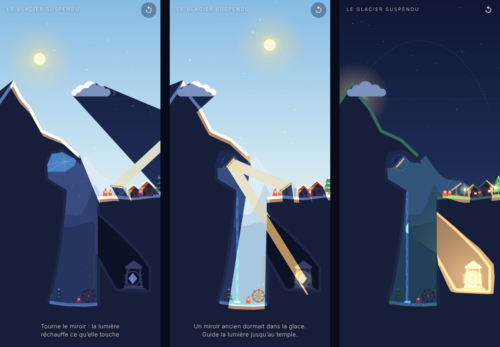

# Equinox

Un jeu d'énigmes d'ombre et de lumière, en portrait, pour téléphone.
Déplace le soleil, écarte les nuages, oriente les miroirs — et rallume les
temples d'une civilisation solaire oubliée sous la glace.



**État actuel : v0.6** — le jeu comptera six chapitres de dix niveaux. Le
premier chapitre, « La source », est complet : dix niveaux jouables de bout
en bout. À partir du niveau 6, le sanctuaire a plusieurs cristaux, à éclairer
en même temps avec plusieurs miroirs. Le monde vit (animaux qui réagissent à
la lumière, vent, village qui dort et se réveille) et il a du son ; tout cela
est réglé au niveau 1 pour l'instant.

| | Niveau | Ce qu'on y apprend |
| --- | --- | --- |
| 1 | Le glacier suspendu | La lumière réchauffe ; les miroirs la guident |
| 2 | Le rideau d'eau | L'ombre gèle l'eau calme : elle devient un outil |
| 3 | La digue de glace | L'ombre du relief retient l'eau et la fait monter |
| 4 | Le pont de givre | Le petit peuple agit quand le monde le lui permet |
| 5 | L'aiguille | Un miroir sur rail : le soleil et sa place règlent le reflet |
| 6 | L'œil de pierre | Deux cristaux, deux miroirs ; un conduit porte la lumière à l'abri |
| 7 | La corniche | La neige qui tombe comble ou barre : l'ordre compte |
| 8 | La veillée | La nuit : des cristaux gardent la lumière du jour |
| 9 | Les jumeaux | Deux miroirs enchaînés, qui tournent à l'envers l'un de l'autre |
| 10 | Le grand glacier | Trois cristaux, trois miroirs, un seul soleil |

La progression est gardée sur l'appareil. Après l'écran titre, on choisit un
chapitre puis un niveau ; le bouton ☰ y ramène. Tous les niveaux construits
sont ouverts, pour faciliter les tests ; les autres apparaissent grisés.

## Technologies

| Besoin | Choix | Pourquoi |
| --- | --- | --- |
| Langage | JavaScript moderne (modules ES) | Simple à lire, aucun outil exotique |
| Dessin | Canvas 2D, sans moteur de jeu | Les ombres nettes sont du calcul géométrique sur mesure ; un moteur n'apporterait rien |
| Outil de dev | [Vite](https://vite.dev) | Rechargement instantané, build en un clic |
| Démo | PWA (manifeste + service worker) | S'installe sur le téléphone depuis le navigateur, marche hors-ligne |
| Android (étape 2) | [Capacitor](https://capacitorjs.com) | Emballe le même code en APK / AAB |

Le jeu complet pèse environ 30 Ko.

## Lancer le jeu sur son ordinateur

Il faut [Node.js](https://nodejs.org) (version 20 ou plus).

```bash
npm install     # une seule fois
npm run dev     # lance le jeu
```

Le terminal affiche deux adresses :

- `Local` — à ouvrir dans le navigateur de l'ordinateur ;
- `Network` — à ouvrir sur le téléphone, s'il est sur le même Wi-Fi.

Chaque modification d'un fichier recharge le jeu tout seul.

Autres commandes :

```bash
npm run check   # vérifie que chaque niveau est résoluble, sans raccourci
npm run build   # fabrique la version finale dans dist/
npm run preview # sert dist/ pour tester la version finale
```

## Tester la démo PWA sur son téléphone

Le dépôt contient une recette de publication automatique vers GitHub Pages
(`.github/workflows/deploy.yml`). Pour l'activer, une seule fois :

1. Sur GitHub : **Settings → Pages → Source : « GitHub Actions »**.
2. Avoir le code sur la branche `main` (la publication se lance à chaque mise
   à jour de `main`, ou à la main depuis l'onglet **Actions**).
3. Ouvrir sur le téléphone : `https://labarthejulien1-bit.github.io/Equinox/`
4. Dans Chrome : menu **⋮ → Ajouter à l'écran d'accueil**. Le jeu se lance
   alors en plein écran, comme une application, même sans réseau.

> GitHub Pages est gratuit pour les dépôts publics. Pour un dépôt privé, il
> faut un abonnement GitHub payant — ou une alternative gratuite comme
> Netlify ou Cloudflare Pages (il suffit d'y déposer le dossier `dist/`).

## Organisation du code

```
index.html              page unique : canvas + interface
src/
  main.js               point d'entrée : boucle de jeu
  style.css             mise en page, écran titre, carte souvenir
  engine/               briques réutilisables d'un niveau à l'autre
    light.js            ★ rayons, zones éclairées, reflets des miroirs
    input.js            gestes tactiles (soleil, nuage, miroirs, bulles, simple toucher)
    audio.js            le son, fabriqué par le navigateur (aucun fichier)
    vec.js              petites fonctions mathématiques
  game/
    game.js             ★ règles : la glace fond, l'eau gèle, la porte s'ouvre…
    render.js           ★ dessin : palette d'ombre + palette de lumière
    palette.js          toutes les couleurs (ère glaciaire → dégel)
    underground.js      dessin de l'eau dans la roche, en coupe : veines et nappes
    machine.js          dessin de la machine à eau : roue, chaîne, contrepoids, porte
    decor.js            dessin des petits décors : animaux, cairns, buissons, fleurs
    life.js             la vie du monde : ce que font les animaux, le vent, le village
    lifeDraw.js         dessin du reste de la vie : empreintes, neige soufflée, poussières…
    progress.js         niveaux terminés, gardés sur l'appareil
    sliders.js          bulles du bas de l'écran (soleil et nuage au pouce)
  levels/
    index.js            les six chapitres et leurs niveaux, dans l'ordre
    terrain.js          outil pour écrire le relief en tronçons nommés
    level1.js … level10.js  un fichier par niveau : formes, positions, textes
  ui/ui.js              écran titre, choix du chapitre et du niveau, indices, souvenir
public/                 icône, manifeste PWA, service worker
scripts/check-level.mjs test automatique de tous les niveaux
docs/GAME_DESIGN.md     le document de conception du jeu
```

Pour comprendre le jeu, lis dans l'ordre : `levels/level1.js` (ce qu'il y a
dans la scène), `game/game.js` (comment ça réagit), `engine/light.js`
(comment la lumière se propage).

### Les briques d'un niveau

Un niveau est une liste d'éléments ; les règles sont les mêmes partout.

| Dans le fichier du niveau | Ce que c'est | Sa règle |
| --- | --- | --- |
| `sun`, `cloud` | soleil sur son arc, nuage sur son rail (facultatif) | déplacés par le joueur |
| `ground`, `snow`, `caves` | le relief | bloque la lumière |
| `mirrors` | miroirs (sur mât, pris dans la glace, sur radeau, portés, sur rail, jumelés) | renvoient la lumière ; celui sur rail ne tourne pas, il glisse ; deux jumeaux (`twin`) tournent à l'envers l'un de l'autre |
| `ices`, `fills` | glaciers, corniches de neige ; ce qu'une corniche comble en tombant | fondent à la lumière, une fois pour toutes (`beamOnly` : seulement sous un reflet ; `after` : n'apparaît qu'après la fonte d'une autre) |
| `frosts` | eaux calmes : source, digue, pont | gèlent à l'ombre, dégèlent à la lumière |
| `streams` | cours d'eau (tronçons qui coulent ou qui tombent) | coulent si leur source est ouverte ; une cascade peut arrêter la lumière |
| `basins` | bassins | se remplissent quand leur digue est gelée |
| `wheels`, `doors` | roues à eau, portes de pierre | l'eau fait tourner la roue dans le sens du courant ; par une chaîne sans fin, un contrepoids monte et la porte descend |
| `walkers` | porteurs | avancent tant que le chemin les porte (pont gelé, crevasse comblée : `gates`), puis posent leur miroir |
| `temple` | le temple et son cristal, ou ses cristaux (`crystals`) | s'allume quand tous ses cristaux reçoivent de la lumière en même temps |
| `eyes` | conduit des anciens : un œil d'entrée, un œil de sortie | l'œil d'entrée éclairé allume l'œil de sortie, qui éclaire les miroirs proches |
| `memories` | cristaux-mémoire | se chargent à la lumière, puis éclairent les miroirs proches dans le noir |
| `sun.max` au-delà de 180 | la nuit | le soleil passe sous l'horizon : tout est à l'ombre, l'eau calme gèle |
| `houses`, `decor` | huttes du village ; animaux, cairns, buissons, fleurs, fanions | les huttes font de l'ombre ; les décors ne changent rien à l'énigme, mais les animaux réagissent à la lumière (voir `life.js`) |
| `veins`, `aquifers` | l'eau dans la roche, vue en coupe : une fissure gelée en amont, une nappe qui se remplit en aval | décor seulement ; montre d'où vient l'eau et où elle repart |
| `mists`, `blooms` | brume du matin dans un creux ; lignes où les fleurs poussent à la victoire | décor seulement |

## Comment marche la lumière

1. Tout ce qui bloque la lumière (sol, nuage, glace, maisons, miroirs) est
   décrit par des **segments**.
2. Depuis le soleil, on lance un rayon vers chaque extrémité de segment : les
   points touchés, reliés entre eux, forment la **zone éclairée**.
3. Un miroir éclairé renvoie un **faisceau** (loi de la réflexion), qui peut
   toucher un autre miroir, et ainsi de suite.
4. À l'écran, la scène est dessinée deux fois : en couleurs d'ombre partout,
   puis en couleurs de lumière uniquement dans les zones éclairées. La
   frontière nette entre les deux est la signature visuelle du jeu.

## Étape 2 : l'application Android (APK / AAB)

Rien n'est à réécrire : Capacitor emballe le dossier `dist/`.

```bash
npm install @capacitor/core @capacitor/android
npm install -D @capacitor/cli
npx cap init Equinox com.equinox.game --web-dir dist
npm run build
npx cap add android
npx cap sync
npx cap open android      # ouvre Android Studio → Build → APK ou Bundle (AAB)
```

Il faut [Android Studio](https://developer.android.com/studio) sur
l'ordinateur — ou bien une recette GitHub Actions qui fabrique l'APK dans le
cloud (à ajouter à l'étape 2).

## Travailler avec Claude Code

Le fichier `CLAUDE.md` explique le projet à Claude à chaque session. Exemples
de demandes qui marchent bien :

- « Écris les énoncés des dix niveaux du chapitre II, en suivant `docs/GAME_DESIGN.md`. »
- « Dans le niveau 1, rends le glacier deux fois plus long à fondre. »
- « Change la couleur de la neige dans l'ombre pour un bleu plus violet. »
