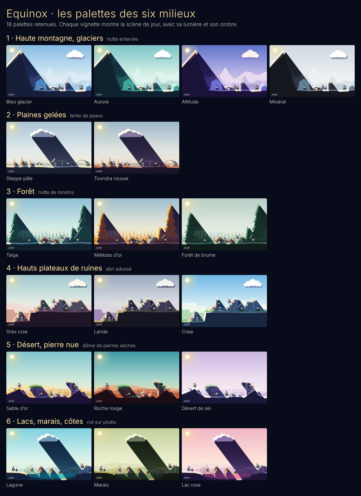
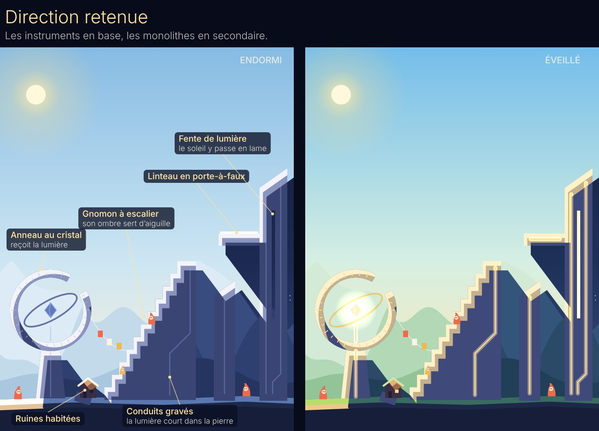
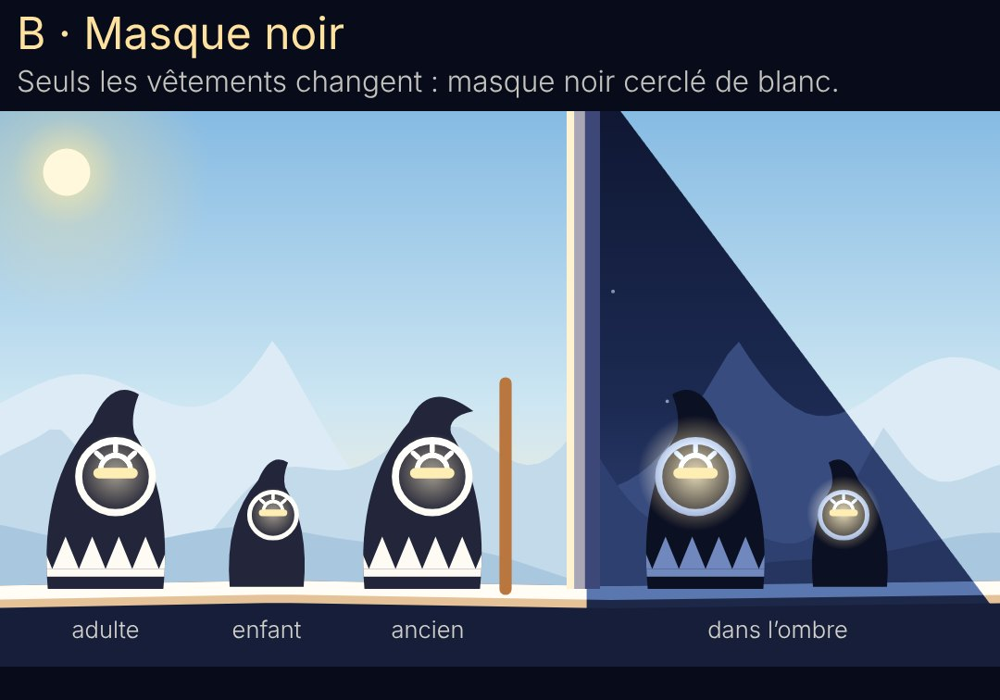

# Equinox — document de conception

Ce document fixe la vision du jeu et propose des réponses aux points encore
ouverts. Ce qui est marqué ✅ existe déjà dans le code ; le reste est une
proposition à valider.

## 1. Le jeu en une phrase

Un puzzle contemplatif où l'on déplace le soleil pour que la lumière et
l'ombre transforment le paysage, jusqu'à rallumer un temple ancien.

- Genre : puzzle 2D, chill, systémique. Orientation portrait.
- Une partie = un niveau = une scène fixe = un temple à rallumer.
- Ni chrono, ni score, ni échec : on ne peut pas « perdre », seulement
  chercher.

## 2. Les trois piliers

1. **La lumière est le seul outil.** Le joueur ne touche jamais directement à
   l'eau, à la glace ou aux mécanismes : il déplace des sources de lumière et
   des obstacles, et le monde réagit.
2. **Rien n'est scripté.** Chaque élément suit une règle simple et locale. La
   solution est une réaction en chaîne que le joueur déclenche étape par
   étape ; plusieurs chemins peuvent mener au temple.
3. **L'ombre est aussi belle que la lumière.** La frontière nette entre les
   deux est la signature visuelle, et les deux moitiés du monde doivent donner
   envie d'être regardées.

## 3. Univers et récit

### L'histoire ✅

Une civilisation maîtrisait la lumière du soleil. Elle a vu venir l'ère
glaciaire, et plutôt que de lutter, elle a **préparé le retour** :

- elle a scellé ses temples et ses machines sous la glace, pour les protéger
  du temps ;
- elle a laissé à ses descendants un geste simple à répéter — tourner un
  miroir vers le soleil — pour qu'ils sachent un jour tout réveiller.

Les siècles ont passé. Le geste est devenu un rite, le rite un culte du
soleil, et plus personne ne sait pourquoi on le fait. Le petit peuple vit au
milieu des ruines sans les comprendre.

Le joueur ne répare donc pas un désastre : il **tient une promesse** dont tout
le monde a oublié l'existence.

Ce que cette histoire explique déjà dans le jeu :

- un miroir attendait dans le glacier du niveau 1 : il y avait été déposé ;
- les temples sont intacts sous la glace : elle les protégeait ;
- le village tourne son miroir « parce qu'on a toujours fait ainsi » ;
- l'ombre et le froid sont des outils, pas des ennemis.

### La fin du jeu ✅

Au dernier temple, on découvre que tout avait été prévu pour ce retour : le
culte du soleil était un mode d'emploi déguisé, et chaque niveau franchi
était une étape du plan des anciens.

### Le sens du titre ✅

Tout le jeu, comme toute l'ancienne civilisation, repose sur un équilibre du
monde entre l'ombre et la lumière. Cet équilibre est parfait un seul jour :
l'équinoxe. Le dernier temple ne s'allume que ce jour-là.

Conséquence pour le jeu : ni la lumière ni l'ombre n'est « la bonne ». Chaque
énigme demande de doser les deux, et le dernier monde les met à égalité.

### Les six chapitres ✅

Le jeu compte **60 niveaux** : six chapitres de dix niveaux, un chapitre par
milieu. Chaque chapitre fait avancer l'histoire.

| Chapitre | Titre | Milieu | Ce qu'on y apprend des anciens | Ce que le joueur apporte |
| --- | --- | --- | --- | --- |
| I | La source | Haute montagne, glaciers | ils guidaient la lumière | la lumière |
| II | Les grandes ombres | Plaines gelées | ils mesuraient le soleil | la lumière |
| III | Le peuple de la forêt | Forêt | ils en faisaient de la chaleur | la lumière |
| IV | Miroir de la vie | Lacs, marais, côtes | ils la confiaient à l'eau | les deux |
| V | La brûlure | Désert, pierre nue | ils ont connu l'excès inverse | l'ombre |
| VI | L'Equinox | Hauts plateaux de ruines | ils nous attendaient | l'équilibre |

Pourquoi cet ordre :

- **On suit l'eau.** Le premier temple fait fondre le glacier ; cette eau
  descend vers la toundra, la forêt, les lacs, puis la mer.
- **Le monde se réchauffe en avançant** : les palettes passent du blanc-bleu
  à la paille, au vert, au turquoise, puis à l'or.
- **Le déséquilibre s'inverse** : trois chapitres où l'on apporte la lumière,
  un chapitre d'eau où les deux comptent, le désert où l'on apporte l'ombre,
  puis un dernier chapitre qui demande les deux à égalité.
- **Les ruines sont pour la fin** : les hauts plateaux sont la ville des
  anciens, là où l'on comprend que tout était prévu.

Deux idées d'histoire proposées, pas encore validées :

- **Un calendrier.** Le voyage commence au solstice d'hiver et se termine le
  jour de l'équinoxe ; chaque chapitre rapproche de cette date.
- **Le désert comme avertissement.** Les anciens y auraient trop appelé le
  soleil, qui n'est jamais reparti. C'est pour cela qu'ils cherchaient
  l'équilibre, et non la lumière à tout prix.

### Ce que rend chaque temple

- un **souvenir** — un fragment de texte, à la manière d'une tradition orale ;
- une **technologie** — un nouvel objet de jeu pour les niveaux suivants ;
- un peu de **chaleur** — la palette glisse du blanc-bleu vers le vert et l'or.

Les souvenirs racontent l'histoire à l'envers : d'abord ce que les anciens
savaient faire, puis qu'ils ont vu venir l'hiver, enfin qu'ils attendaient
quelqu'un.

Le tableau ci-dessous donne cet arc en cinq temps. Il a été écrit quand le
jeu était pensé comme un seul monde gelé ; ses souvenirs restent à
redistribuer sur les six chapitres ci-dessus.

| Temps du récit | Ambiance d'origine | Ce qu'on y apprend des anciens | Souvenir |
| --- | --- | --- | --- |
| I. Les glaces | blanc, bleu nuit | ils guidaient la lumière | ✅ « Ils ne priaient pas le soleil : ils le guidaient. » |
| II. Le dégel | turquoise, premiers verts | ils en faisaient de la chaleur | « La lumière serrée dans le poing devient flamme. » |
| III. Les eaux | vert, brume | ils la confiaient à l'eau | « Ce que le soleil réveille, l'eau le porte. » |
| IV. Les vents | or, ocre | ils ont vu venir le froid | « Le ciel se fermait. Nous avons compté les étés qu'il restait. » |
| V. L'équinoxe | or et nuit à parts égales | ils ont tout préparé pour nous | « Nous avons rangé le jour sous la glace. À vous de l'ouvrir. » |

La répartition des dix machines entre les milieux reste à faire (voir § 7).

## 4. Contrôles

Tactile uniquement, un seul doigt, uniquement des « glisser ».

| Objet | Geste | État |
| --- | --- | --- |
| Soleil | glisser le long de son arc | ✅ |
| Nuage | glisser le long de son rail | ✅ |
| Bulles du bas de l'écran | glisser la bulle soleil ou la bulle nuage sur sa ligne : toute la largeur de l'écran = toute la course de l'objet. Pour jouer d'une main, au pouce | ✅ |
| Miroir | tourner le doigt autour du miroir (aide à la visée au lâcher) | ✅ |
| Miroir flottant | idem ; sa hauteur suit le niveau de l'eau | ✅ |
| Porteur de miroir | aucun geste : il avance dès que le chemin le porte | ✅ |
| Lentille | glisser sur un rail, comme le nuage | proposé |
| Vanne / écluse | toucher pour ouvrir ou fermer | proposé |
| Girouette | tourner : change le sens du vent | proposé |
| Lanterne portée | glisser un villageois porteur de lanterne sur un chemin | proposé |

Règle d'ergonomie : zone tactile d'au moins 48 px, jamais deux objets
manipulables à moins de 60 px l'un de l'autre, jamais de geste à deux doigts.

## 5. Direction artistique

Inspirations : Alto's Adventure (aplats, plans successifs, ciel dégradé) et
Prune (silhouettes, économie de moyens).

- **Deux palettes, une frontière.** ✅ Chaque couleur existe en version
  lumière (chaude) et en version ombre (froide). La scène est peinte en ombre,
  puis repeinte en lumière dans les zones éclairées : le bord est net, sans
  flou ni dégradé.
- **Aube et crépuscule.** ✅ Le jour ne s'allume pas d'un coup : la lumière
  monte à mesure que le soleil se dégage du relief, rose et dorée tant qu'il
  est bas, blanche au zénith. Une lumière faible agit faiblement (fonte
  lente).
- **La nuit vit dans l'ombre.** ✅ Les étoiles n'apparaissent que là où le
  soleil ne passe pas.
- **La lumière mord la matière.** ✅ Sur les surfaces éclairées, un liseré
  clair (neige blanche, roche dorée) ; son épaisseur dépend de l'angle du
  soleil.
- **Silhouettes sombres au premier plan**, lointains pâles : la profondeur
  vient de la valeur, pas du détail.
- **Formes** : polygones simples, peu de sommets, pas de contour, pas de
  texture.
- **Mouvement** : lent et continu (flocons, respiration des personnages,
  reflets de l'eau). Rien ne clignote.
- **Progression** : la neige devient herbe, le ciel se réchauffe ✅ ; plus
  tard les arbres reverdissent et le village s'agrandit.

Sources de lumière : soleil ✅, faisceaux des miroirs ✅, temple allumé ✅,
lanternes ✅ ; à venir : feu, cristal chargé, lucioles, lune (lumière froide
qui éclaire sans chauffer).

## 5 bis. Les palettes par milieu

**18 palettes retenues** ✅, réparties sur les six milieux :

| Milieu | Palettes retenues | Habitation |
| --- | --- | --- |
| 1 · Haute montagne, glaciers | Bleu glacier, Aurore, Altitude, Minéral | hutte enterrée |
| 2 · Plaines gelées | Steppe pâle, Toundra rousse | tente de peaux |
| 3 · Forêt | Taïga, Mélèzes d'or, Forêt de brume | hutte de rondins |
| 4 · Hauts plateaux de ruines | Grès rose, Lande, Craie | abri adossé |
| 5 · Désert, pierre nue | Sable d'or, Roche rouge, Désert de sel | dôme de pierres sèches |
| 6 · Lacs, marais, côtes | Lagune, Marais, Lac rose | nid sur pilotis |

Avec 60 niveaux pour 18 palettes (dix niveaux par milieu), chaque palette
sert à trois ou quatre niveaux. Encore à décider : ce que devient chaque palette quand le temple
s'allume (le « dégel » n'a de sens que dans les milieux froids), et les
teintes d'aube propres à chaque milieu.

État : seule la palette Bleu glacier est dans le jeu aujourd'hui.

Chaque milieu a plusieurs palettes, qu'on fait varier d'un niveau à l'autre.
Une palette donne, pour chaque élément, sa couleur **au soleil / dans
l'ombre**. Les personnages (noir et blanc) et l'or des feux et des masques
ne changent pas d'une palette à l'autre.

### Milieu 1 — Haute montagne, glaciers ✅

Quatre palettes retenues. Planches :
[A et B](images/palettes-montagne-A-B.jpg), [C et D](images/palettes-montagne-C-D.jpg).

| | A · Bleu glacier | B · Aurore | C · Altitude | D · Minéral |
| --- | --- | --- | --- | --- |
| Esprit | la palette d'origine, neutre | sarcelle, aurore la nuit | indigo et rose, air raréfié | presque noir et blanc |
| Ciel (haut) | `#86bbe3` / `#0f1733` | `#7cc4c9` / `#0b1a2b` | `#5f73c9` / `#120c2e` | `#cfd8df` / `#11141b` |
| Ciel (milieu) | `#cde6f2` / `#1c2a52` | `#cfeee4` / `#143646` | `#b9b4e6` / `#241a55` | `#e8edf0` / `#1d222d` |
| Horizon | `#fff0d6` / `#324578` | `#fdeee0` / `#226063` | `#ffd2c4` / `#45357f` | `#fbf6ec` / `#333a48` |
| Lointain 1 | `#dcebf5` / `#394c7f` | `#dff3ee` / `#2a6a6a` | `#e6d9f0` / `#4a3d88` | `#eef1f3` / `#3a4250` |
| Lointain 2 | `#c3daeb` / `#2e406f` | `#bfe3dc` / `#215a5e` | `#c9bde6` / `#3b2f74` | `#dde2e6` / `#2f3643` |
| Lointain 3 | `#a9c7df` / `#253560` | `#9fcfc9` / `#1a4a52` | `#aa9fd6` / `#2e2460` | `#c7cfd6` / `#262c38` |
| Neige | `#fffdf6` / `#5a77b0` | `#fbfffb` / `#4c9c98` | `#fff5f0` / `#7468c4` | `#ffffff` / `#77818f` |
| Liseré de roche | `#e6c298` / `#1d2848` | `#e9c9a4` / `#17303a` | `#f0b08e` / `#22184a` | `#d9cdbd` / `#1a1e27` |
| Corps de la roche | `#161e39` | `#0f2230` | `#1a1238` | `#14171e` |
| Eau | `#8fe3f7` / `#2f60a8` | `#8ff0dc` / `#1f7a80` | `#b9c6ff` / `#4a48b0` | `#c4dbe6` / `#3e5466` |
| Nuage | `#ffffff` / `#7b91be` | `#ffffff` / `#6fa8a8` | `#fff2ee` / `#8478c8` | `#ffffff` / `#8a93a0` |
| Glace (clair / corps) | `#eafaff` / `#4a88c6` | `#effffa` / `#3aa79a` | `#f4f2ff` / `#6a6fd6` | `#f4fbff` / `#5f7f96` |
| Pierre ancienne (clair / corps) | `#fff3d2` / `#3d4878` | `#fff3d2` / `#33506a` | `#ffeed6` / `#463a7a` | `#fffaf0` / `#3a404d` |

Écartée pour ce milieu : « Or froid » (lumière dorée, ombres bleu pétrole),
trop proche d'une aube permanente.

État : choisies, **pas encore dans le jeu** (seule A y est, c'est la palette
actuelle).

### Milieu 2 — Plaines gelées ✅

Deux palettes retenues. Planche : [Steppe pâle et Toundra rousse](images/palettes-plaines.jpg).

| | A · Steppe pâle | C · Toundra rousse |
| --- | --- | --- |
| Esprit | paille et bleu gris, l'herbe sèche perce la neige | sol roux de mousses et de lichens, neige en plaques |
| Ciel (haut) | `#a9c4d6` / `#151a2e` | `#9db7c9` / `#16142a` |
| Ciel (milieu) | `#dfe9ea` / `#262d47` | `#dfe4e0` / `#2a2442` |
| Horizon | `#f7efd9` / `#3f4664` | `#f6e6d2` / `#463a5c` |
| Lointain 1 | `#e3e6dc` / `#444a66` | `#e6ddd4` / `#4a3e5e` |
| Lointain 2 | `#d2d6c4` / `#3a405a` | `#d7c4b6` / `#40344f` |
| Lointain 3 | `#bfc3a8` / `#30364e` | `#c4a898` / `#362a42` |
| Sol | `#fbf8ee` / `#6c7696` (neige) | `#c9603a` / `#5a2c40` (mousse rousse) |
| Plaques de neige | — | `#fffaf0` / `#8a80a8` |
| Herbe, lichen | `#c9a85a` / `#5a5448` | `#f3b04a` / `#6a4a4a` |
| Liseré de roche | `#d9c08a` / `#232840` | `#e0a070` / `#281c34` |
| Corps de la roche | `#1a1e33` | `#1c1428` |
| Eau | `#a8d8e6` / `#3a5a7a` | `#9fd0e0` / `#3a4f78` |
| Nuage | `#ffffff` / `#7f89a8` | `#fff8f0` / `#857a9c` |
| Pierre ancienne (clair / corps) | `#fff3d2` / `#414866` | `#fff0d0` / `#463e62` |

Écartées pour ce milieu : « Banquise » (blanc et cyan, trop proche de
l'Aurore de la montagne) et « Ciel d'acier » (gris-bleu d'orage).

Décor propre aux plaines, apparu sur les planches : un **troupeau** de bêtes
à bois (la tribu est nomade) et **l'ombre du nuage** qui traverse toute la
plaine, très lisible sur un terrain plat.

### Milieu 3 — Forêt ✅

Trois palettes retenues. Planche : [Taïga, Mélèzes d'or, Forêt de brume](images/palettes-foret.jpg).

| | A · Taïga | B · Mélèzes d'or | C · Forêt de brume |
| --- | --- | --- | --- |
| Esprit | sapins sous la neige, ombres bleu canard | forêt d'automne, ombres prune | vert-de-gris et mousse, lumière laiteuse |
| Ciel (haut) | `#8fc0d4` / `#0c1a2a` | `#9fbfd0` / `#141428` | `#b9cfc6` / `#0e1a18` |
| Ciel (milieu) | `#d2e9e6` / `#16303f` | `#e6e6d6` / `#28223c` | `#dfe9e0` / `#1a2e2a` |
| Horizon | `#f6f1dc` / `#254a58` | `#ffe9c0` / `#43334f` | `#f4f1e2` / `#2c4a42` |
| Collines lointaines | `#d5e6e0` / `#2a505c` | `#f0dcb8` / `#4a3a52` | `#dbe6dc` / `#2f4d45` |
| Lisière 1 | `#9fc2b4` / `#1f3f4a` | `#e0b46a` / `#4a3040` | `#b6cdbc` / `#243e38` |
| Lisière 2 | `#6f9f90` / `#16303a` | `#c98a3a` / `#3c2434` | `#8fb09a` / `#1a302c` |
| Sol | `#fbfdf8` / `#5586a0` (neige) | `#e6b45a` / `#6a4050` (feuilles) | `#cfe0c0` / `#3f6a58` (mousse) |
| Feuillage (clair / moyen / corps) | `#8fd0a0` / `#3f8a72` / `#173a3a` | `#ffd060` / `#d08a2e` / `#5a3030` | `#a6d6b0` / `#4a8068` / `#16302a` |
| Tronc (clair / corps) | `#d0a070` / `#2a2630` | `#c08a60` / `#2a2030` | `#b8b090` / `#22282a` |
| Liseré de roche | `#d6c29a` / `#142a36` | `#d98a4a` / `#261a2e` | `#c9c7a4` / `#142622` |
| Corps de la roche | `#0f1f2b` | `#1a1424` | `#0f1c1a` |
| Eau | `#8fdcea` / `#1f5a78` | `#9fd4e0` / `#34507a` | `#a9d6cf` / `#1f5550` |
| Pierre ancienne (clair / corps) | `#fff3d2` / `#35506a` | `#fff0d0` / `#463e60` | `#f6f4dc` / `#30504a` |

Écartée pour ce milieu : « Bouleaux » (troncs blancs, feuillage vert tendre).

Propre à la forêt : **les arbres font de l'ombre.** Un grand sapin coupe une
clairière en deux ; c'est le milieu où le relief n'est plus seul à cacher le
soleil. À surveiller : la Forêt de brume est la moins contrastée des trois,
la frontière ombre / lumière s'y lit moins bien.

### Milieu 4 — Hauts plateaux de ruines ✅

Trois palettes retenues. Planche : [Grès rose, Lande, Craie](images/palettes-plateaux.jpg).

| | B · Grès rose | C · Lande | D · Craie |
| --- | --- | --- | --- |
| Esprit | roche rose et sauge, ombres lie-de-vin | herbe olive et bruyère violette, ciel gris | falaises blanches, gazon vert vif, grand ciel bleu |
| Ciel (haut) | `#9fc6cf` / `#12202a` | `#9aa9c0` / `#12121e` | `#6fb6e6` / `#0c1a36` |
| Ciel (milieu) | `#e2ece4` / `#203640` | `#d9dde0` / `#201f32` | `#cfe9f4` / `#172f56` |
| Horizon | `#ffeedd` / `#3a5258` | `#f4ecd0` / `#383650` | `#fffbe6` / `#2a4c78` |
| Plateaux lointains 1 | `#f0dcd4` / `#4a4a5a` | `#dcd6e0` / `#3e3856` | `#eef6ee` / `#2f5078` |
| Plateaux lointains 2 | `#e4bfb4` / `#4a3c4e` | `#c0b0cc` / `#352c4c` | `#d2ead2` / `#27466a` |
| Plateaux lointains 3 | `#d6a294` / `#422f42` | `#a48bb8` / `#2c2242` | `#b2dab4` / `#1f3b5a` |
| Sol | `#e8a890` / `#6a3f52` (grès) | `#b9b45a` / `#4a4a38` (herbe) | `#7fc66a` / `#2c5f5a` (gazon) |
| Herbe, buissons | `#8fae7a` / `#3a5548` (sauge) | `#b06aa8` / `#5a2f5c` (bruyère) | `#4f9f4a` / `#1f4a48` |
| Taches au sol | `#f6dccf` / `#8a6478` | `#d98ac0` / `#6a3a6c` | `#fbfaf2` / `#5d79a6` |
| Falaise (liseré) | `#f2c0a0` / `#2a1e30` | `#c9b48a` / `#1c1a2a` | `#fbfaf2` / `#5d79a6` |
| Corps de la roche | `#1e1626` | `#161522` | `#1a2740` |
| Eau | `#9fd6d8` / `#2a5a66` | `#9ab8d6` / `#2c3e66` | `#6fd0ea` / `#1f5aa0` |
| Nuage | `#fff6f0` / `#6f8f98` | `#f4f4f0` / `#6c6e88` | `#ffffff` / `#7494c0` |
| Pierre ancienne (clair / corps) | `#fff2dc` / `#4a4060` | `#fff6d6` / `#3e3e58` | `#fffdf0` / `#3a4c78` |

Écartée pour ce milieu : « Pierre de lune » (ivoire et lavande).

Propre aux plateaux : c'est le milieu où il y a **le plus d'ombre**, parce que
les ruines se cachent le soleil les unes aux autres. Le Grès rose étant
retenu ici, le désert doit partir dans une autre direction de couleur.

### Milieu 5 — Désert, pierre nue ✅

Trois palettes retenues. Planche : [Sable d'or, Roche rouge, Désert de sel](images/palettes-desert.jpg).

| | A · Sable d'or | B · Roche rouge | C · Désert de sel |
| --- | --- | --- | --- |
| Esprit | dunes jaunes, ciel turquoise, ombres indigo | terre cuite et rouge sombre, ombres presque noires | sol blanc, ciel lilas, ombres bleu violet |
| Ciel (haut) | `#7fc4cf` / `#141033` | `#3f9aa6` / `#07181c` | `#c9b6e0` / `#151230` |
| Ciel (milieu) | `#cfe9dc` / `#27204f` | `#a9d6cc` / `#0f2c30` | `#eedff0` / `#28244e` |
| Horizon | `#fff2c8` / `#45376e` | `#ffe2b0` / `#1f4a4a` | `#ffeee4` / `#44407a` |
| Dunes lointaines 1 | `#f6e2b0` / `#4a3c72` | `#e6b08a` / `#3a2a34` | `#f4e9f2` / `#4a4680` |
| Dunes lointaines 2 | `#ecc98a` / `#403264` | `#cf7f5a` / `#32202a` | `#e6d6ea` / `#3f3b70` |
| Dunes lointaines 3 | `#deb06a` / `#352856` | `#b45a40` / `#2a1822` | `#d6c2e0` / `#343060` |
| Sable | `#f6cf7a` / `#5f4a8a` | `#c9553a` / `#4a1c28` | `#ffffff` / `#7f7fc0` |
| Herbe sèche | `#b89a4a` / `#3f3558` | `#d9a04a` / `#4a2c2c` | `#c9b0a0` / `#4f4a70` |
| Taches au sol | `#fbe6a8` / `#6f5a98` | `#f0a070` / `#5a2a34` | `#f0e4f4` / `#6f6fb0` |
| Liseré de roche | `#e0a050` / `#241a40` | `#e07a4a` / `#200f18` | `#e9dcd6` / `#22203f` |
| Corps de la roche | `#1c1436` | `#1a0d14` | `#1a1838` |
| Eau (oasis) | `#5fc8d0` / `#2a4a8a` | `#4fc0c0` / `#145058` | `#a8e0e6` / `#3a5a9a` |
| Feuillage (clair / moyen / corps) | `#b9d07a` / `#6f9a5a` / `#2a3a40` | `#a8d08a` / `#5f9a6a` / `#1f3a34` | `#d6e6c0` / `#8fa890` / `#2c3450` |
| Pierres sèches (clair / moyen / corps) | `#fff0c4` / `#d0b488` / `#54466e` | `#ffc89a` / `#c8785a` / `#4f2a34` | `#ffffff` / `#d0cade` / `#4c4a82` |
| Pierre ancienne (clair / corps) | `#fff2cc` / `#4a4070` | `#ffe8c8` / `#4a3040` | `#ffffff` / `#484680` |

Écartée pour ce milieu : « Cendre » (sable noir volcanique). Le sol y reste
sombre même au soleil, donc l'ombre s'y lit mal et les capes noires s'y
perdent.

Propre au désert : **pas de nuage.** L'ombre y est rare et précieuse ; elle
vient des dunes, des ruines et des acacias, sous lesquels les villageois se
tiennent. Le Désert de sel, avec son sol blanc, est la palette où les ombres
se lisent le mieux de tout le jeu.

### Milieu 6 — Lacs, marais, côtes ✅

Trois palettes retenues. Planche : [Lagune, Marais, Lac rose](images/palettes-lacs.jpg).

| | A · Lagune | B · Marais | D · Lac rose |
| --- | --- | --- | --- |
| Esprit | eau turquoise et sable clair, ombres bleu profond | olive et ocre, eau sombre, brume jaune pâle | eau rose, rives blanches, ombres violettes |
| Ciel (haut) | `#7fd0e0` / `#0c1c34` | `#c2cf9a` / `#10160e` | `#f0b6c6` / `#1a1030` |
| Ciel (milieu) | `#d2f0ec` / `#16324e` | `#e6ecc8` / `#1f2a1a` | `#fbdcd6` / `#30204c` |
| Horizon | `#fff6dc` / `#28506a` | `#fbf4d6` / `#35452c` | `#fff3d8` / `#523a70` |
| Rives lointaines 1 | `#dff0e6` / `#2c566c` | `#dfe4bf` / `#3a4a30` | `#f6dfe0` / `#584074` |
| Rives lointaines 2 | `#bfe0d2` / `#22485c` | `#c2cc98` / `#2e3c28` | `#e9c4d0` / `#4a3464` |
| Rives lointaines 3 | `#9fcdbb` / `#1a3a4c` | `#a3b278` / `#243020` | `#d8a6c0` / `#3c2a54` |
| Rivage | `#fbeecb` / `#5f7a96` (sable) | `#b8b86a` / `#3f4a30` (herbe) | `#fff8f0` / `#7a6aa8` (sel) |
| Roseaux | `#6fae6a` / `#2a5550` | `#d9a84a` / `#5a4a2a` | `#9a7a9a` / `#4a3a5c` |
| Galets | `#ffffff` / `#7f9ab4` | `#e9e0a0` / `#5a6040` | `#ffe0ea` / `#8a6a98` |
| Eau | `#3fc4c8` / `#0f5a74` | `#6f8a5a` / `#1c2c22` | `#f08aa8` / `#6a2f6a` |
| Reflets sur l'eau | `#e6ffff` / `#6fc0d0` | `#dfe8b0` / `#6f8a6a` | `#fff0f4` / `#c890c0` |
| Liseré de roche | `#e6cf9a` / `#152a40` | `#b89a5a` / `#161e14` | `#e9c0b0` / `#281a40` |
| Corps de la roche | `#12203a` | `#12180f` | `#1c1436` |
| Nuage | `#ffffff` / `#6f9ab4` | `#f6f6e2` / `#6a7a5a` | `#ffffff` / `#8a70a8` |
| Pierre ancienne (clair / corps) | `#fff6d8` / `#34507a` | `#f6f2cc` / `#3a4a3a` | `#fff4e0` / `#4a3c70` |

Écartée pour ce milieu : « Fjord » (eau bleu profond), trop proche du Bleu
glacier de la montagne.

Propre aux lacs : **l'eau montre très bien les ombres.** L'ombre d'un nuage y
dessine une bande nette. À surveiller : dans le Marais, l'eau sombre et les
ombres vert-noir se confondent ; c'est la palette la moins lisible du jeu.

## 5 ter. Les décors par milieu

Chaque milieu a son catalogue de décors, rangés en quatre familles : la
faune, la flore et les roches, ce qui est propre au milieu (glace, eau,
sable…), et les traces laissées par le peuple et par les anciens. Les niveaux
piochent dedans.

Deux sortes de décors :

- **ceux qui jouent** : ils font de l'ombre, arrêtent la lumière, fondent ou
  gèlent. Ils sont posés par le niveau, comme n'importe quel élément ;
- **ceux qui font vivre le monde** : animaux, fleurs, traces. Ils n'ont pas
  d'effet sur l'énigme, mais ils suivent la règle commune : une couleur au
  soleil, une couleur dans l'ombre.

Règle des couleurs chaudes : dans un monde froid, avec des personnages en
noir et blanc, tout ce qui est orange ou rouge (lichens, baies, feu) attire
l'œil. On en met peu, et jamais près de ce que le joueur doit regarder.

**139 décors retenus** ✅ sur les six milieux :

| Milieu | Décors | La famille propre au milieu | L'élément clé |
| --- | --- | --- | --- |
| 1 · Haute montagne, glaciers | 22 | glace et neige | la glace, qui fond et qui gèle |
| 2 · Plaines gelées | 24 | glace, neige et eau | le gnomon : sur un sol plat, toute ombre est longue |
| 3 · Forêt | 24 | sous-bois, eau et brume | la trouée de lumière dans le feuillage |
| 4 · Hauts plateaux de ruines | 24 | ruines des anciens | l'oculus et les ruines, qui se cachent le soleil |
| 5 · Désert, pierre nue | 22 | sable, vent et eau | l'ombre, rare et précieuse |
| 6 · Lacs, marais, côtes | 23 | eau, lumière et marées | le miroir d'eau |

Plusieurs décors demandent une règle que le jeu n'a pas encore. Elles sont
notées milieu par milieu ; en voici la liste :

- une ombre qui se déplace toute seule (le mammouth) ;
- un voile qui affaiblit la lumière sans l'arrêter (vapeur, brume, tourbillon
  de sable) ;
- un miroir brisé, qui renvoie plusieurs petits rayons ;
- l'eau qui s'évapore au soleil et reste à l'ombre ;
- un objet poussé par le vent (le virevoltant) ;
- l'eau calme qui reflète la lumière, et les vagues qui brisent le reflet ;
- la marée.

État : les premiers décors de la montagne sont dans le niveau 1 (bouquetin,
marmottes, lièvre, rapace, cairn, buisson à baies, fanions). Le reste n'est
pas encore dans le jeu.

### Milieu 1 — Haute montagne, glaciers ✅

Planches : [faune, flore et roches](images/decors-montagne-1.jpg),
[glace, neige et traces du peuple](images/decors-montagne-2.jpg). Les numéros
sont ceux des planches.

| Famille | Retenus | Ceux qui jouent |
| --- | --- | --- |
| Faune | bouquetin (1), marmottes (2), grand rapace (3), lièvre des neiges (5), traces dans la neige (6) | — |
| Flore et roches | rocher à lichens (2), fleurs d'altitude (3), aiguille rocheuse (4), éboulis et bloc perché (5), buisson à baies rouges (6) | l'aiguille (ombre très longue), le bloc perché |
| Glace et neige | séracs (1), crevasse (2), lac gelé (3), arche de glace (4), stalactites (5), corniche de neige (6) | tous : la glace fond, gèle, laisse passer ou arrête la lumière |
| Traces du peuple et des anciens | cairn (1), fanions (2), pont de corde (3), traîneau (4), borne ancienne (5), feu de camp (6) | le pont de corde (un chemin pour les porteurs), le feu (une lumière de nuit) |

Écartés : le lagopède (faune 4) et le pin couché par le vent (flore 1).

Détail à garder : le lièvre est blanc. Il se fond dans la neige au soleil et
ressort dans l'ombre, à l'inverse des personnages.

Pistes de ciel, non dessinées : un panache de neige soufflé au sommet, une mer
de nuages en contrebas, l'aurore de nuit (déjà dans la palette Aurore).

### Milieu 2 — Plaines gelées ✅

Planches : [faune, flore et roches](images/decors-plaines-1.jpg),
[glace, neige, eau et traces du peuple](images/decors-plaines-2.jpg). Les
24 éléments sont retenus.

| Famille | Retenus | Ceux qui jouent |
| --- | --- | --- |
| Faune | mammouth laineux (1), troupeau de bêtes à bois (2), renard des neiges (3), chouette blanche (4), vol d'oies (5), ossements géants (6) | le mammouth (une ombre qui marche), les ossements (une ombre rayée) |
| Flore et roches | herbes sèches (1), linaigrettes (2), bouleau nain (3), bloc erratique (4), coussins de mousse et de lichen (5), roseaux (6) | le bloc erratique |
| Glace, neige et eau | butte de glace (1), congères (2), rivière gelée (3), glaces empilées (4), source chaude (5), neige soufflée par le vent (6) | la butte et les glaces (elles fondent), la rivière (elle gèle), la vapeur de la source (elle tamise la lumière) |
| Traces du peuple et des anciens | séchoir à poissons (1), mât aux bois (2), trou de pêche (3), enclos (4), route ancienne (5), gnomon et ses bornes (6) | le gnomon, cadran solaire des anciens |

Propre aux plaines :

- **Tout ce qui dépasse compte.** Sur un sol plat, la moindre chose dressée
  projette une ombre longue et très lisible.
- **Le gnomon** : une grande pierre dressée par les anciens, et des bornes au
  sol. Son ombre passe de borne en borne quand le soleil se déplace. C'est une
  énigme toute trouvée pour ce milieu.
- **Une barre horizontale fait une grande ombre** dans ce monde en coupe
  (sous le séchoir, sous l'enclos). À placer avec soin dans les niveaux.

Règles à ajouter au jeu si on s'en sert : une ombre qui se déplace toute seule
(le mammouth), une vapeur qui affaiblit la lumière sans l'arrêter (la source
chaude).

Piste de ciel, non dessinée : un halo autour du soleil, avec deux faux soleils
de chaque côté, comme on en voit par grand froid.

### Milieu 3 — Forêt ✅

Planches : [faune, flore et roches](images/decors-foret-1.jpg),
[sous-bois, eau, brume et traces du peuple](images/decors-foret-2.jpg). Les
24 éléments sont retenus.

| Famille | Retenus | Ceux qui jouent |
| --- | --- | --- |
| Faune | élan (1), ours (2), loup (3), écureuil (4), pic à tête rouge (5), lucioles (6) | les lucioles (elles n'apparaissent que dans l'ombre) |
| Flore et roches | fougères (1), champignons (2), arbre mort (3), rocher moussu (4), arbre creux (5), grand mélèze (6) | les arbres : un tronc met dans l'ombre tout ce qui est derrière lui |
| Sous-bois, eau et brume | trouée de lumière (1), tronc couché (2), ruisseau et cascade (3), barrage de castors (4), nappe de brume (5), toile d'araignée (6) | la trouée, le tronc couché (un pont), le barrage (une digue), la brume, la toile (sa rosée brille quand un rayon la touche) |
| Traces du peuple et des anciens | tas de bûches et billot (1), lanternes (2), tronc sculpté (3), charbonnière (4), arche prise dans les racines (5), miroir avalé par un arbre (6) | les lanternes (lumières de nuit), le miroir avalé |

Propre à la forêt :

- **La trouée de lumière.** Sous les arbres tout est dans l'ombre, sauf un
  rayon qui tombe par un trou du feuillage. Déplacer le soleil déplace ce
  rayon. C'est l'énigme propre à ce milieu, et c'est le milieu le plus sombre
  du jeu : la lumière y est rare.
- **Des indices qui ne bloquent rien.** Les lucioles montrent où est l'ombre,
  la rosée de la toile montre où passe un rayon.
- **Le miroir avalé par un arbre** est l'équivalent du miroir pris dans la
  glace du niveau 1. À décider : comment on le libère.
- **La nature refait les règles connues** : le barrage de castors est une
  digue, le tronc couché est un pont.

Règle à ajouter au jeu si on s'en sert : une brume qui affaiblit la lumière
sans l'arrêter (la même règle que la vapeur de la source chaude des plaines).

### Milieu 4 — Hauts plateaux de ruines ✅

Planches : [faune, flore et roches](images/decors-plateaux-1.jpg),
[ruines des anciens et traces du peuple](images/decors-plateaux-2.jpg). Les
24 éléments sont retenus.

Dans ce milieu, les ruines des anciens forment une famille à part, et les
traces du peuple une autre.

| Famille | Retenus | Ceux qui jouent |
| --- | --- | --- |
| Faune | chèvres (1), corbeaux (2), lézard au soleil (3), lapins (4), papillons (5), poneys sauvages (6) | le lézard (il sort au soleil, se cache à l'ombre) |
| Flore et roches | bruyère (1), coquelicots (2), aubépine tordue (3), cheminée de pierre (4), arche naturelle (5), cascade dans le vide (6) | la cheminée et l'arche (de grandes ombres), la cascade |
| Ruines des anciens | colonnade brisée (1), escalier interrompu (2), dalle à oculus (3), anneau gradué tombé (4), grand miroir brisé (5), linteau en porte-à-faux (6) | toutes |
| Traces du peuple | étendoir (1), potager dans un bassin (2), échelle et passerelle (3), ruches (4), cerf-volant (5), autel aux bougies (6) | l'échelle et la passerelle (un chemin pour les porteurs) |

Propre aux plateaux :

- **Les ruines sont les éléments de jeu.** Elles reprennent les pièces des
  temples (§ 7) : l'oculus ne laisse passer qu'un mince rayon, qui dessine une
  tache de lumière au milieu de l'ombre ; le linteau en porte-à-faux fait une
  ombre suspendue, avec de la lumière en dessous ; la colonnade fait une ombre
  rayée.
- **Le lézard est l'inverse des lucioles de la forêt** : il montre où est la
  lumière.
- **Le peuple vit dans les ruines sans les comprendre** : il étend son linge
  entre les colonnes, cultive dans un bassin ancien, et pose des bougies au
  pied d'un cristal qu'il ne sait plus allumer.
- **La mer de nuages** s'étend sous le bord du plateau ; la cascade y tombe.

Règle à ajouter au jeu si on s'en sert : un miroir brisé qui renvoie plusieurs
petits rayons dans des directions différentes, au lieu d'un seul.

### Milieu 5 — Désert, pierre nue ✅

Planches : [faune, flore et roches](images/decors-desert-1.jpg),
[sable, vent, eau et traces du peuple](images/decors-desert-2.jpg). Les
numéros sont ceux des planches.

| Famille | Retenus | Ceux qui jouent |
| --- | --- | --- |
| Faune | dromadaires (1), gazelles (2), fennec (3), serpent et sa trace (4), scorpion (5) | — |
| Flore et roches | acacia parasol (1), cactus candélabre (2), virevoltant (3), fleurs du désert (4), rose des sables (5), surplomb et point d'eau (6) | l'acacia et le surplomb (de l'ombre), le point d'eau, le virevoltant (le vent le pousse) |
| Sable, vent et eau | dune à crête vive (1), sable soufflé par le vent (2), oasis (3), tourbillon de sable (5), mirage (6) | la dune, l'oasis, le tourbillon (il voile la lumière) |
| Traces du peuple et des anciens | puits à balancier (1), voile d'ombre (2), jarres d'eau (3), cuisine au miroir (4), temple englouti (5), champ de miroirs ensablé (6) | la voile d'ombre, le champ de miroirs, le temple |

Écartés : le scarabée et sa boule (faune 6) et le sol craquelé (sable 4).

Propre au désert :

- **Ici, c'est l'ombre qui est précieuse.** Le peuple tend une voile pour s'en
  fabriquer, garde ses jarres dessous, et l'eau ne subsiste que sous le
  surplomb. Cela va dans le sens du déséquilibre proposé au § 8 : dans le
  désert, on apporterait l'ombre plutôt que la lumière.
- **La dune à crête vive** est la signature du jeu à l'état naturel : un
  versant au soleil, l'autre dans l'ombre, séparés par une arête nette.
- **La cuisine au miroir** : le peuple chauffe sa marmite avec un vieux miroir
  courbe, sans savoir ce que c'est.
- **Le champ de miroirs ensablé** offre plusieurs miroirs d'un coup : une base
  pour des énigmes à reflets en chaîne.
- **Le temple englouti** est le pendant du temple sous la glace ; ici c'est le
  sable qui l'a recouvert.

Règles à ajouter au jeu si on s'en sert : l'eau qui s'évapore au soleil et
reste à l'ombre (le miroir de la règle du gel), le tourbillon qui voile la
lumière en se déplaçant, le virevoltant poussé par le vent.

### Milieu 6 — Lacs, marais, côtes ✅

Planches : [faune, flore et roches](images/decors-lacs-1.jpg),
[eau, lumière, marées et traces du peuple](images/decors-lacs-2.jpg). Les
numéros sont ceux des planches.

| Famille | Retenus | Ceux qui jouent |
| --- | --- | --- |
| Faune | héron (1), flamants roses (2), grenouille sur son nénuphar (3), libellules (4), banc de poissons (5), crabe (6) | — |
| Flore et roches | saule pleureur (1), nénuphars et lotus (2), iris des marais (3), palétuvier (4), algues (5), rocher à coquillages (6) | le saule et le palétuvier (de l'ombre sur l'eau) |
| Eau, lumière et marées | miroir d'eau (1), vagues (2), îlot (3), marée basse (5), arc-en-ciel (6) | le miroir d'eau, les vagues, la marée |
| Traces du peuple et des anciens | pirogue (1), ponton (2), filets qui sèchent (3), lanternes flottantes (4), ruines englouties (5), phare des anciens (6) | la pirogue, le ponton, les lanternes (lumières de nuit), le miroir englouti, le phare |

Écarté : le gué de pierres (eau 4).

Propre aux lacs :

- **Le miroir d'eau.** Une eau calme renvoie la lumière comme un miroir
  couché ; des vagues brisent le reflet. C'est l'élément clé de ce milieu.
- **On voit sous l'eau**, puisque le jeu est en coupe : poissons, algues,
  ruines englouties. Un miroir au fond de l'eau ouvre des énigmes où la
  lumière doit plonger.
- **Le phare des anciens** est la machine à lumière de la côte ; il est
  éteint, comme les temples.
- **Les ombres se lisent très bien sur l'eau** (sous les flamants, sous le
  ponton).

Règles à ajouter au jeu si on s'en sert : l'eau calme qui reflète la lumière
et les vagues qui brisent le reflet, la marée qui fait monter et descendre
l'eau (à décider : ce qui la commande).

## 5 quater. La vie du monde ✅

Le monde paraît vivant quand il **répond à la lumière et à l'ombre**, qui
sont justement ce que le joueur manipule. Seize idées retenues, plus le son.
Règle d'or : tout cela reste du décor. Rien ne change l'énigme, rien ne
bloque la lumière, rien n'est nécessaire pour gagner.

État : ✅ dans le jeu. Réglé et essayé au niveau 1 (v0.6), puis posé dans
les neuf autres niveaux (v0.7) : chaque bouquetin a son chemin, chaque lièvre
sa pente, chaque rapace son perchoir ; fleurs, brume, chouette et yeux dans
la nuit sont placés d'après le relief de chaque niveau. Quelques animaux ont
changé de place pour avoir un endroit où vivre (une marmotte ne creuse pas
dans une falaise). Là où le relief n'offre que des parois, le bouquetin
reste debout et change de prise, sans jamais se coucher.

**A. Les animaux réagissent à la lumière et à l'ombre**

| # | Idée | Règle dans le jeu |
| --- | --- | --- |
| 1 | Se chauffer au soleil | le bouquetin cherche un endroit ensoleillé de son chemin, s'y couche et rumine ; à l'ombre il se lève et s'ébroue. Les marmottes sortent quand le soleil chauffe leur terrier |
| 2 | La sentinelle | une marmotte se dresse et siffle quand une ombre arrive (nuage, rapace) ou qu'un reflet la touche ; l'autre plonge |
| 3 | Le lièvre et le faisceau | touché par un reflet, il s'enfuit en trois bonds, guette, puis revient brouter |
| 4 | Le rapace et son ombre | il plane d'autant plus haut que le soleil est haut ; son ombre glisse sur le relief ; quand le soleil passe derrière la montagne, il se pose |
| 5 | La nuit | les animaux dorment ; une chouette vient se poser et hulule ; deux yeux brillent dans une grotte |
| 6 | Les plantes | les fleurs s'ouvrent à la lumière et se referment à l'ombre ; le buisson plie sous le vent |

**B. Le monde respire**

| # | Idée | Règle dans le jeu |
| --- | --- | --- |
| 7 | Le vent en rafales | toutes les dix à quinze secondes, une rafale traverse l'écran : la neige s'envole des crêtes, les fanions, les fleurs et la fumée se couchent |
| 8 | Les particules | poussières dorées dans les faisceaux, gouttes sous la glace qui fond, embruns au pied des cascades, brume du matin dans les creux |
| 9 | L'eau qui scintille | éclats de soleil sur l'eau éclairée ; ronds dans l'eau et poisson qui saute dans les lacs |
| 10 | Le ciel | longs nuages lointains, étoile filante la nuit, vol d'oiseaux en V |

**C. Le petit peuple vit**

| # | Idée | Règle dans le jeu |
| --- | --- | --- |
| 11 | Des gestes | à l'ombre ils se serrent près du feu de leur hutte et grelottent ; au soleil ils reviennent à leur place et s'étirent ; ils suivent des yeux le reflet qu'on tourne ; leur barre de lumière rayonne quand un cristal s'allume |
| 12 | Le jour et la nuit du village | la nuit ils rentrent dans leur hutte, dont la porte éclaire plus fort ; ils sortent un à un au lever du soleil (sauf au niveau 8, où le village veille) |
| 13 | Les traces | villageois, porteurs et animaux laissent des empreintes dans la neige, qui s'effacent en une vingtaine de secondes |

**D. Des petites scènes**

| # | Idée | Règle dans le jeu |
| --- | --- | --- |
| 14 | Des trajets | le bouquetin change de vire et saute d'un rocher à l'autre ; une marmotte court jusqu'à un second terrier ; le lièvre traverse parfois sa pente |
| 15 | Le toucher | un simple toucher dérange l'animal ou le villageois visé : sifflet, bonds, cri, tintement |
| 16 | Le monde revient à la vie | quand le sanctuaire s'allume : les animaux sortent et s'approchent, des fleurs poussent le long de l'eau, les villageois dansent, un vol d'oiseaux passe |

**Le son.** Tout est fabriqué par le navigateur, sans aucun fichier : un
accord de fond qui s'éclaire avec le jour puis avec le dégel, le vent et ses
rafales, l'eau qui coule, la glace qui craque, la lourde porte qui gronde,
les tintements des miroirs et des cristaux, l'arpège du sanctuaire, et la
voix de chaque animal (sifflet, hululement, cri du rapace). Il se règle
dans le menu (coupé ou non, volume). Tout ce qui tinte est accordé sur une même gamme de cinq notes.

## 5 quinquies. Les objectifs secondaires et les médailles ✅

Chaque niveau propose **trois objectifs à côté de l'énigme** : ils ne
servent pas à rallumer le sanctuaire, ils invitent à éveiller le milieu ou
à jouer avec les machines des anciens. Chacun donne une médaille — **cuivre,
argent, or**, du plus simple au plus fin. Trente médailles pour le
chapitre I.

Règles de conception :
- un objectif ne se gagne jamais sans rien faire, et il est toujours
  atteignable depuis le début du niveau : le test automatique le prouve en
  rejouant sa « recette » (`scripts/goal-recipes.mjs`, qui sert aussi
  d'antisèche) ;
- le cuivre apprend un geste (toucher un animal, faire glisser un rail), l'argent
  demande de jouer avec le soleil ou le nuage, l'or demande de viser juste
  avec un miroir ou de réunir plusieurs conditions ;
- les objectifs d'état (marmottes dehors, fleurs ouvertes, bouquetin
  couché) ne comptent que tant que le sanctuaire dort : une fois rallumé,
  le monde s'éveille tout seul.

| Niveau | Cuivre | Argent | Or |
| --- | --- | --- | --- |
| 1 | toucher la chouette | amener le soleil sur les marmottes | poser un reflet sur le cairn du sommet |
| 2 | toucher le rapace en vol | faire siffler la sentinelle d'un reflet | réveiller le buisson à l'ombre avec un reflet |
| 3 | toucher le lac : un poisson saute | ouvrir toutes les fleurs ensemble | éblouir le rapace avec le reflet du radeau |
| 4 | toucher le bouquetin | faire de l'ombre aux marmottes | ouvrir la fleur de la rive avec un reflet |
| 5 | promener le miroir sur son rail | renvoyer la lumière vers le ciel | ouvrir les deux fleurs ensemble |
| 6 | faire tinter chaque villageois | faire détaler le lièvre d'un reflet | ouvrir la fleur de la crête avec un reflet |
| 7 | renvoyer la lumière vers le ciel | faire siffler la sentinelle d'un reflet | éblouir le rapace |
| 8 | coucher le soleil : le rapace se pose | voir une étoile filante | la même nuit, toucher la chouette et les yeux de la grotte |
| 9 | faire tinter chaque villageois | faire de l'ombre au bouquetin couché | le grand éveil : bouquetin couché et fleurs ouvertes ensemble |
| 10 | promener le miroir sur son rail | faire passer l'ombre du nuage sur les marmottes | éblouir le rapace |

Trois réactions ont été ajoutées à la vie du monde pour l'occasion : un
reflet éblouit le rapace en plein vol, un poisson saute quand on touche un
lac libre de glace, et le jeu retient ce qui a dérangé un animal (l'ombre,
un reflet, le doigt).

**Où les voir.** Trois pastilles sous le nom du niveau ; le menu ☰ liste les
trois objectifs et leur médaille ; la liste des niveaux montre les pastilles
de chacun ; la liste des chapitres donne le total ; la carte souvenir les
rappelle à la fin du niveau. Une annonce passe en haut de l'écran quand une
médaille est gagnée, avec un petit carillon (plus riche pour l'or).

**Le menu et les réglages.** Le bouton ☰ ouvre le menu de la partie :
objectifs, reprendre, choisir un niveau, réglages, recommencer. Les
réglages : son, volume, indices (les phrases d'aide), annonce des médailles,
effacer la progression (deux touchers), numéro de version.

## 6. Système d'éléments

Le principe : chaque élément ne connaît que ce qu'il **reçoit**.

### Briques de base

| Brique | Ce qu'elle apporte | Vient de |
| --- | --- | --- |
| Lumière | chaleur + visibilité | soleil, miroir, lentille, temple, feu |
| Ombre | froid | relief, nuage, objets |
| Eau | poids, mouvement, vie | glace fondue, pluie, source |
| Vent | déplacement | girouette, cheminée de roche chauffée |
| Terre | support, obstacle | le décor |
| Feu | lumière + chaleur locales, même la nuit | lumière concentrée sur du bois |
| Pluie | eau venue d'en haut | nuage refroidi par une ombre ou poussé contre un sommet |

### Tableau des réactions

| Ce qui reçoit | + Lumière | + Ombre | + Eau | + Vent | + Feu |
| --- | --- | --- | --- | --- | --- |
| **Glace** | fond → eau ✅ | reste gelée | — | — | fond vite |
| **Eau** | dégèle ✅ ; s'évapore lentement → nuage | gèle → glace (source, digue, pont) ✅ | coule, remplit ✅ | fait des vagues, pousse un radeau | → vapeur → nuage |
| **Terre humide** | pousse → végétation | reste nue | devient humide | sèche | durcit → brique |
| **Végétation** | grandit (liane, pont, échelle) | se referme, dort | grandit | disperse des graines | brûle → cendre fertile |
| **Nuage** | s'amincit | grossit → pluie | — | se déplace | — |
| **Miroir** | renvoie un faisceau ✅ | inactif | — | — | — |
| **Cristal** | se charge ✅ puis éclaire | se décharge lentement | — | tinte (indice sonore) | — |
| **Roue** | — | — | tourne → actionne un mécanisme ✅ | tourne (moulin) | — |
| **Bois** | — | — | flotte | — | brûle → feu |

États produits : **glace**, **végétation**, **vapeur/nuage**, **feu**,
**cendre**. Chaque état doit se lire au premier coup d'œil et réagir à son
tour : c'est ce qui permet les réactions en chaîne.

Règle d'or pour ajouter un élément : il doit réagir à au moins deux briques
et en produire ou en transporter au moins une. Sinon, c'est du décor.

### Les éléments d'énigme ✅

Pour atteindre le cristal, la lumière doit être déviée, parfois teintée,
parfois divisée ; les temples les plus difficiles demandent plusieurs
lumières. Dix-neuf éléments retenus. Planches :
[dévier et colorer](images/elements-enigme-1.jpg),
[diviser, créer, temples exigeants](images/elements-enigme-2.jpg). Les numéros
sont ceux des planches (le 10 et le 17 ont été écartés).

**Les deux teintes.** Le prisme sépare la lumière du soleil en une lumière
chaude et une lumière froide ; réunies, elles redonnent la lumière blanche.
C'est l'équilibre de l'équinoxe, appliqué à la lumière. La teinte n'est pas
qu'une clé : elle change la façon dont le monde réagit.

| Lumière | Ce qu'elle fait |
| --- | --- |
| Blanche (celle du soleil) | éclaire et réchauffe, comme dans le jeu actuel |
| Chaude | réchauffe fort : fait fondre, sécher, pousser ; allume un brasero |
| Froide | éclaire sans chauffer : la glace et le givre tiennent |

Un faisceau peut aussi être **faible** (la moitié d'un faisceau normal) : il
éclaire, mais ne suffit pas seul à allumer un cristal.

| # | Élément | Verbe | Règle |
| --- | --- | --- | --- |
| 1 | Miroir sur rail ✅ | dévier | il ne tourne pas, il glisse le long de son rail (dans le jeu depuis le niveau 5) |
| 2 | Miroirs jumelés ✅ | dévier | reliés par une chaîne : quand l'un tourne, l'autre tourne à l'envers (dans le jeu au niveau 9) |
| 3 | Tournesol de bronze | dévier | il suit le soleil tout seul et renvoie toujours au même endroit ; il faut le garder éclairé |
| 4 | Miroir courbe | dévier | il ouvre le faisceau en éventail : la lumière va partout, mais elle est faible |
| 5 | Lentille de glace | dévier | elle dévie le faisceau ; la lumière chaude la fait fondre, la froide la traverse sans dégât |
| 6 | Prisme | teinter | il sépare la lumière blanche en un faisceau chaud et un faisceau froid |
| 7 | Verre teinté | teinter | un vitrail à deux carreaux qu'on fait glisser ; le faisceau prend la teinte du carreau traversé |
| 8 | Teintes naturelles | teinter | chaque milieu a son filtre : la glace donne une lumière froide, l'ambre et le verre de sable une lumière chaude |
| 9 | Creuset | réunir | deux faisceaux entrent, un seul sort ; chaud et froid redonnent du blanc |
| 11 | Miroir sans tain | diviser | la moitié de la lumière passe, l'autre est renvoyée : deux faisceaux faibles |
| 12 | Paupière de pierre | commander | elle ne s'ouvre que si son œil est éclairé : un premier faisceau ouvre le passage au second |
| 20 | Brasero | créer | une lumière chaude l'allume ; il éclaire et réchauffe ensuite autour de lui, même à l'ombre |
| 21 | Phare des anciens | créer | éteint au départ ; quand son œil reçoit de la lumière, il s'allume pour de bon et projette son propre faisceau, qu'on oriente |
| 13 | Cristal teinté | exiger | son anneau montre la teinte qu'il attend ; toute autre lumière le laisse éteint |
| 14 | Cristaux multiples ✅ | exiger | le temple a deux ou trois cristaux, à éclairer en même temps ; chacun n'est atteignable que par un miroir précis (dès le niveau 6) |
| 15 | Cristal d'équinoxe | exiger | il s'allume quand la frontière passe en son milieu : une moitié au soleil, l'autre dans l'ombre |
| 16 | Cristal de nuit | exiger | l'inverse d'un cristal : il s'éveille quand on lui apporte l'ombre |
| 18 | Serrure à ordre | exiger | trois cristaux à allumer dans le bon ordre, sans chronomètre : un cristal allumé le reste |
| 19 | Lotus de lumière | porter | il s'ouvre au soleil et porte un villageois ; il se referme dès que l'ombre revient |

Écartés : le pochoir à signe (10) et la balance de lumière (17).

Comment ils s'articulent avec le reste :

- Le **prisme** est la machine 6 du § 7, dont la règle est maintenant précise.
  Les neuf autres machines restent valables et s'ajoutent à cette liste.
- Le **phare des anciens** est aussi un décor des lacs (§ 5 ter) ; il peut
  servir dans d'autres milieux. C'est une seconde source de lumière, fixe, qui
  marche même quand le soleil est caché.
- Le **cristal d'équinoxe** fait de la frontière nette entre ombre et lumière
  la solution elle-même : il est tout désigné pour le dernier temple.
- Le **cristal de nuit** donne un but aux niveaux du désert, où l'on apporte
  l'ombre.
- Chacun n'a qu'un seul geste (tourner **ou** glisser), pour rester jouable
  d'un pouce.

Encore à décider, au moment de les construire :

- la teinte du faisceau du phare (blanche, ou celle de la lumière qui l'a
  réveillé) ;
- ce que la lumière froide fait à l'eau (la laisse-t-elle geler ?) et ce que
  la lumière chaude fait de plus que la blanche, en chiffres ;
- comment montrer les teintes à un joueur qui distingue mal les couleurs (par
  exemple un faisceau froid en pointillé).

État : choisis, **pas encore dans le jeu**.

### Introduction progressive

Un seul nouvel élément par niveau, d'abord en situation évidente, puis
combiné avec les précédents deux ou trois niveaux plus tard.

## 7. Les temples de l'ancienne civilisation

**Direction retenue** ✅ : *les instruments* en base, *les monolithes* en
secondaire. Chaque bâtiment est un instrument qui mesure le ciel, taillé dans
de grandes dalles nettes. (Écartée : la piste « orgues », des machines de
bronze à tuyaux et chaudières, trop chargée pour un écran de téléphone.)

### L'idée

Ils ne fabriquaient pas d'énergie : ils traitaient la lumière comme de l'eau.
Ils la captaient, la conduisaient dans la pierre, la gardaient, puis la
changeaient en chaleur, en mouvement ou en vie.

### Les règles de dessin

- **Trois formes** : l'arc, le triangle, l'escalier droit. Aucun ornement.
- **Des coupes nettes** : grandes faces planes, sommets en biseau, arêtes
  vives. C'est ce qui donne les ombres les plus franches.
- **Une seule gravure** : les conduits, lignes fines à angle droit ou à 45°.
- **Une matière** : une pierre claire et lisse. Le bronze est réservé aux
  pièces mobiles (miroirs, anneaux).
- **Deux états** : endormi (pierre bleu froid, gravures presque invisibles,
  cristal terne) et éveillé (gravures dorées, cristal lumineux).
- **Une échelle** : les ruines dominent le paysage ; une maison du village
  arrive à peine à la troisième marche.
- **La forme annonce la fonction** : on doit deviner à quoi sert un lieu avant
  de toucher quoi que ce soit.

### Les pièces

| Pièce | Vient de | Rôle | État |
| --- | --- | --- | --- |
| Porte solaire (deux piliers, un fronton) | instruments | abrite le cristal | ✅ dans le jeu |
| Anneau au cristal | instruments | reçoit la lumière ; ses graduations indiquent l'angle | ✅ (version simple) |
| Conduits gravés | instruments | portent la lumière dans la pierre | ✅ |
| Gnomon à escalier | instruments | grand triangle dont l'ombre sert d'aiguille | à faire |
| Oculus | instruments | trou rond : ne laisse passer qu'un rayon précis | à faire |
| Dalle en biseau | monolithes | mur, écran, porte | à faire |
| Fente de lumière | monolithes | la lumière y passe en lame | à faire |
| Linteau en porte-à-faux | monolithes | fait une ombre « suspendue » | à faire |

À ne pas reprendre des monolithes : les blocs en lévitation. Le jeu obéit à
des règles physiques ; rien n'y flotte.

### Les machines ✅

Dix machines retenues. Chacune suit une seule règle et réagit à ce qu'elle
reçoit ; on les répartira au fil des niveaux pour varier les énigmes.
Planches de référence : [machines 1 à 5](images/machines-1-5.jpg),
[machines 6 à 10](images/machines-6-10.jpg).

| # | Machine | Verbe | Règle | Énigme type | Coût |
| --- | --- | --- | --- | --- | --- |
| 1 | Oculus | filtrer | ne laisse passer qu'un rayon, sous un angle précis | trouver la position exacte du soleil | léger |
| 2 | Lentille sur rail | concentrer | rassemble la lumière en un point brûlant | aligner soleil, lentille et cible | moyen |
| 3 | Cristal-mémoire ✅ | garder | se charge au soleil, puis éclaire quelques secondes | avoir lumière et ombre « en même temps » | moyen |
| 4 | Conduit ✅ | conduire | la lumière entre par un œil et ressort par un autre | atteindre un lieu fermé | léger à moyen |
| 5 | Poumon de pierre | mouvoir | se dilate à la lumière, se rétracte à l'ombre | monter ou descendre un miroir, un villageois | moyen |
| 6 | Prisme | diviser | sépare la lumière en un faisceau chaud et un faisceau froid (voir § 6) | deux cibles avec un seul soleil | léger à moyen |
| 7 | Cadran d'ombre | mesurer | la pointe de l'ombre sert de clé | poser l'ombre sur la bonne graduation | moyen |
| 8 | Vanne solaire | libérer l'eau | s'ouvre à la lumière, se referme à l'ombre | décider où va l'eau | léger |
| 9 | Serre | faire pousser | lumière et eau font pousser une liane | un pont vivant, qui fait aussi de l'ombre | lourd |
| 10 | Cheminée à vent | souffler | chauffée, elle pousse le nuage | déplacer le nuage avec la lumière | moyen |

S'y ajoute l'héliostat (miroir orientable), déjà dans le jeu.

Règle d'introduction : une seule machine nouvelle par niveau, d'abord seule,
puis combinée avec les précédentes deux ou trois niveaux plus tard.

### Pourquoi tout s'est arrêté ✅

Ils ont vu venir l'ère glaciaire et ont choisi de mettre leur monde en
sommeil, en préparant son réveil (voir § 3). Les temples ne sont donc pas des
ruines de guerre ou d'abandon : ils sont **rangés**. Portes closes, miroirs
repliés, cristaux éteints, le tout pris dans une glace qui a été voulue.

Conséquence pour le dessin : ce qui est abîmé l'est par le temps (un anneau
ébréché, une dalle couchée), jamais par la violence.

### Les ruines aujourd'hui

- Toujours abîmées d'un côté : un anneau ébréché, une dalle couchée, un
  escalier qui ne mène plus nulle part.
- Prises dans la glace, noyées ou envahies de végétation selon le monde.
- **Habitées sans être comprises** ✅ (sur la planche) : maisons adossées à un
  gnomon, linge tendu entre un anneau et un escalier, enfants sur les marches.

### Variantes par milieu (pistes)

Temple-phare au sommet (montagne), temple-écluse à bassin en gradins (lacs),
temple-forge à lentille (désert), temple enfoui sous les racines (forêt),
temple à ciel ouvert sur son parvis (plateaux), temple-girouette dans le vent
(plaines). Le dernier temple, celui de l'équinoxe, a des portes jumelles :
une pour le jour, une pour la nuit.

## 8. Le petit peuple et son village

### Les personnages ✅

- **Silhouette** : une goutte encapuchonnée, sans bras ni jambes visibles. La
  pointe de la capuche est leur seul « geste ».
- **Vêtement** : cape noire, frise de triangles blancs à l'ourlet. Le noir se
  détache sur la neige et sur le ciel.
- **Masque** : un petit disque noir cerclé de blanc, porté dans l'ouverture
  de la capuche. Au-dessus, un soleil levant tracé en blanc. Il reprend les
  formes des anciens (cercle, triangle, graduations), pas celles d'une
  culture réelle.
- **La barre de lumière** : à la place des yeux, un trait doré qui brille.
  Dans l'ombre, la cape disparaît et il ne reste presque que lui : c'est ce
  qu'ils ont gardé des anciens sans le savoir.
- **Déclinaisons** : l'enfant est plus petit et sans frise ; l'ancien a la
  pointe de capuche recourbée et un bâton ; le porteur a son miroir dans le
  dos.
- **Comportement** : ils respirent ✅, sautent de joie quand le temple
  s'allume ✅. À venir : se tourner vers la lumière, se blottir dans l'ombre,
  s'approcher des objets libérés (indice discret).

État : ✅ dans le jeu depuis la v0.3 (cape, frise, masque, barre de
lumière). Les anciens et les porteurs n'ont pas encore de dessin à part.

Conséquence : le peuple n'apporte plus de couleur chaude. La chaleur du
monde gelé vient désormais des feux et des fenêtres de leurs habitations.

### Les habitations ✅

Le peuple d'aujourd'hui est primitif : il a perdu la technique des anciens.
Il n'y a pas un village mais **plusieurs tribus**, dispersées, chacune avec
sa façon de bâtir. Un niveau montre un petit village d'un seul type, choisi
selon le lieu. Planches : [habitations 1 à 3](images/habitations-1-3.jpg),
[habitations 4 à 6](images/habitations-4-6.jpg).

| # | Habitation | Ce qu'elle dit de la tribu |
| --- | --- | --- |
| 1 | Hutte de rondins | sédentaire, vit du bois |
| 2 | Tente de peaux | nomade, suit les troupeaux |
| 3 | Dôme de pierres sèches | bâtit avec les blocs des ruines, sans le savoir |
| 4 | Abri adossé à une ruine | vit littéralement dans les restes des anciens |
| 5 | Hutte enterrée | se protège du froid sous la terre et la neige |
| 6 | Nid sur pilotis | vit au-dessus de l'eau ou de la neige profonde |

Règle commune : dans un monde où les personnages sont en noir et blanc, le
feu des portes et des fenêtres est la seule couleur chaude. Chaque
habitation en a un, visible de loin.

### Tribus et milieux ✅

Le jeu traverse **six milieux**. Chaque milieu a sa tribu et son habitat.

| Milieu | Habitation | Pourquoi |
| --- | --- | --- |
| Haute montagne, glaciers | hutte enterrée (5) | le sol protège du froid |
| Plaines gelées | tente de peaux (2) | rien pour bâtir, on se déplace |
| Forêt | hutte de rondins (1) | le bois est partout |
| Hauts plateaux de ruines | abri adossé (4) | les dalles anciennes servent de murs |
| Désert, pierre nue | dôme de pierres sèches (3) | frais le jour, tiède la nuit |
| Lacs, marais, côtes | nid sur pilotis (6) | l'eau monte et descend |

Ce que toutes les tribus ont en commun : la cape noire et le masque à barre
de lumière.

Encore à décider :

- **La répartition des niveaux** ✅ : 60 niveaux en six chapitres de dix, dans
  l'ordre donné au § 3. Reste à écrire l'énoncé des dix niveaux de chaque
  chapitre.
- **Un signe par tribu** (proposé) : le signe tracé au-dessus de la barre de
  lumière changerait d'une tribu à l'autre (soleil levant, graduations, trait
  vertical…), comme si chacune n'avait gardé qu'un fragment du savoir ancien.
- **Le sens du déséquilibre** (proposé) : certains milieux souffrent de trop
  d'ombre (la glace), d'autres de trop de lumière (le désert). Dans les
  premiers on apporte la lumière ; dans les seconds, l'ombre.
- **Les couleurs** : chaque milieu aura besoin de sa palette de lumière et de
  sa palette d'ombre. Seule celle de la glace existe aujourd'hui.

### Le rite

Au centre du village, un miroir sur un mât ✅. Ils le tournent vers le soleil
« parce qu'on a toujours fait ainsi » : c'est le geste que les anciens leur
ont laissé pour réveiller les temples (voir § 3).

## 9. Niveaux

### Niveau 1 — Le glacier suspendu ✅

Décor : un soleil, un nuage sur rail, un glacier coincé sous un surplomb, un
village sur un plateau, une vallée et sa rivière gelée, un temple au fond
d'une grotte fermée par une porte.

1. Sortir le soleil de derrière la montagne ; écarter le nuage si son ombre
   tombe sur le village.
2. Tourner le miroir du village vers le glacier : il fond, la cascade tombe,
   la roue tourne, la porte s'ouvre.
3. Le glacier a libéré un second miroir : village → glacier → temple.

Le soleil direct ne peut atteindre ni le glacier ni le temple (c'est vérifié
par `npm run check`) : les deux miroirs sont nécessaires.

La machine de la porte ✅ (choisie parmi quatre maquettes : treuil, rouages,
ligne de lumière, contrepoids) : la roue tourne dans le sens du courant et
entraîne une **chaîne sans fin** qui monte jusqu'au-dessus de la porte. Un
contrepoids de pierre est accroché au brin qui monte, la porte au brin qui
descend : la pierre s'élève, la porte glisse le long de la falaise. Des
éclats dorés remontent la chaîne pendant qu'elle travaille, pour que tout se
lise même dans l'ombre. L'eau quitte la vallée par une arche au pied de la
falaise.

Le trajet de l'eau ✅ (choisi parmi trois maquettes : rivière souterraine,
nappe, citerne des anciens). Tout est dessiné en coupe dans la roche :
- **en amont**, quand le glacier a fondu, un reste de glace demeure accroché
  au plafond de sa niche : ses glaçons gouttent et un filet ruisselle le
  long de la paroi jusqu'au départ du torrent (la source venue du sommet,
  essayée d'abord, a été écartée) ;
- **en aval**, l'eau entre dans la roche au pied de la falaise, remplit en une vingtaine de
  secondes une petite nappe sous le temple, puis le trop-plein repart en un
  filet vers le bas de l'écran, à droite.

### Niveau 2 — Le rideau d'eau ✅

Le torrent libéré au niveau 1 tombe devant l'entrée du temple : la cascade
brise le faisceau. Nouvelle règle : **l'ombre gèle l'eau calme**.

1. Viser le temple : le faisceau se disperse dans la cascade.
2. Amener l'ombre du nuage sur la source : elle gèle, la cascade se tarit.
3. Garder la source à l'ombre et le miroir au soleil, puis viser.

### Niveau 3 — La digue de glace ✅

Un bassin, un miroir sur un radeau, une gorge par où l'eau s'échappe. Pas de
nuage : seule l'ombre du relief compte, donc la position du soleil.

1. Placer le soleil pour que l'ombre de la falaise couvre le seuil : l'eau
   qui le franchit gèle en digue, le bassin se remplit, le radeau monte.
2. Trop bas, le soleil laisse aussi le radeau dans l'ombre : il faut trouver
   la bonne plage.
3. Miroir en haut et au soleil : viser le temple dans la falaise.

### Niveau 4 — Le pont de givre ✅

Un villageois porte un miroir mais le torrent lui barre la route. Le socle
qui l'attend n'est jamais atteint par le soleil direct.

1. Amener l'ombre du nuage sur le torrent : il gèle en pont.
2. Le porteur traverse tout seul et pose son miroir (la glace tient tant
   qu'il est dessus).
3. Écarter le nuage : miroir du village → miroir du socle → temple.

### Chapitre I — La source : les dix niveaux ✅

Les dix niveaux sont dans le jeu (v0.5). Chaque niveau n'apporte qu'une
nouveauté et réutilise celles d'avant. En attendant les palettes des milieux,
ils sont tous dessinés avec la palette Bleu glacier.

| # | Titre | Ce qui est nouveau | Palette |
| --- | --- | --- | --- |
| 1 | Le glacier suspendu ✅ | le miroir, la glace qui fond | Bleu glacier |
| 2 | Le rideau d'eau ✅ | l'ombre gèle l'eau | Bleu glacier |
| 3 | La digue de glace ✅ | l'ombre du relief, le miroir sur radeau | Bleu glacier |
| 4 | Le pont de givre ✅ | le porteur de miroir | Bleu glacier |
| 5 | L'aiguille ✅ | le miroir sur rail | Altitude (pas encore : le jeu n'a que la palette Bleu glacier) |
| 6 | L'œil de pierre ✅ | le conduit ; le sanctuaire à deux cristaux | Altitude |
| 7 | La corniche ✅ | la neige qui tombe ; un miroir caché dans la neige | Minéral |
| 8 | La veillée ✅ | la nuit, les cristaux-mémoire | Aurore |
| 9 | Les jumeaux ✅ | les miroirs jumelés | Minéral |
| 10 | Le grand glacier ✅ | le sanctuaire à trois cristaux | Bleu glacier |

**5 · L'aiguille.** Présents : le soleil, un miroir sur rail, une aiguille
rocheuse, le temple sous un surplomb ; pas de nuage. Le miroir ne tourne
pas : la hauteur du soleil règle la direction du reflet, la place sur le rail
règle son point de départ, et l'ombre de l'aiguille balaie le rail. Solution :
la paire soleil / position où le miroir reste au soleil et où le reflet passe
sous le surplomb. Impossible autrement : le soleil direct n'entre jamais sous
le surplomb.

#### La seconde moitié du chapitre : plusieurs faisceaux ✅

Les niveaux 6 à 10 sont plus longs et plus difficiles que les cinq premiers
(réécrits après l'essai des niveaux 1 à 5). Ce qui change :

- **Le sanctuaire a plusieurs cristaux** : deux aux niveaux 6 à 9, trois au
  niveau 10. Il ne s'allume que si tous reçoivent de la lumière **en même
  temps**. Chaque cristal montre son état, pour que le joueur voie où il en
  est.
- **Un miroir, un cristal.** Chaque cristal n'est atteignable que par un
  miroir précis ; il faut donc autant de faisceaux que de cristaux.
- **Un seul soleil pour tous les miroirs** : le déplacer dérègle tous les
  reflets à la fois. C'est la vraie difficulté.
- **Des préparatifs en chaîne** : chaque miroir se mérite (le sortir de la
  neige ou de la glace, l'apporter, l'éclairer).
- **Rien n'est jamais perdu** : une erreur coûte du temps, jamais un
  recommencement. Il n'y a toujours ni chronomètre ni échec.

Le miroir sans tain et la paupière de pierre ne servent pas dans ce
chapitre : ils sont gardés pour les suivants. (Le miroir sans tain donne des
faisceaux faibles, qui ne suffisent pas à allumer un cristal : il demandera
sa propre règle.)

**6 · L'œil de pierre** — 2 faisceaux, environ 6 gestes.
Présents : le soleil, le nuage, le miroir du hameau, un second miroir sur la
crête, une source et sa cascade, un conduit (une borne sur la crête, sa
jumelle au plafond de l'abri du hameau), le sanctuaire à deux cristaux
derrière la cascade. Le hameau est sous un abri de roche : le soleil n'y
entre jamais, son miroir ne reçoit que la lumière du conduit. Le cristal de
l'entrée n'est visible que de la crête ; celui du fond, que du hameau.

1. Placer le soleil pour qu'il frappe la borne de la crête : sa jumelle
   s'allume sous l'abri et éclaire le miroir du hameau.
2. Viser la grotte : la cascade brise les reflets, comme au niveau 2.
3. Mettre le nuage sur la source : elle gèle, la cascade se tarit.
4. Ajuster : l'ombre du nuage ne doit tomber ni sur la borne ni sur le miroir
   de la crête, tout en couvrant la source.
5. Tourner le miroir du hameau vers le cristal du fond.
6. Tourner le miroir de la crête vers le cristal de l'entrée.

Impossible autrement : le soleil direct n'atteint aucun des deux cristaux ;
aucun des deux miroirs ne voit les deux cristaux. (Changé à la construction :
le hameau est passé sous un abri, sinon son miroir restait au soleil et le
conduit ne servait à rien ; les rôles des deux cristaux ont été échangés.)

**7 · La corniche** — 2 faisceaux, environ 7 gestes.
Présents : le soleil, le nuage, le miroir du village, un porteur, la rimaye
(la crevasse au pied du rocher), deux corniches de neige, un socle, le
sanctuaire dans une cheminée de roche. La corniche du haut cache un miroir
ancien. La cheminée a deux cristaux : celui du bas ne se voit que du socle,
celui du haut que du rebord où dort le miroir ancien.

1. Garder la corniche du haut à l'ombre du nuage : si elle tombe maintenant,
   elle barre le chemin du porteur.
2. Viser la corniche du bas avec le miroir du village : elle s'effondre et
   comble la rimaye.
3. Le porteur, qui attendait au bord du glacier, traverse et pose son miroir
   sur le socle.
4. Écarter le nuage : le soleil fait tomber la corniche du haut, qui ne gêne
   plus personne et libère le miroir ancien.
5. Miroir du village → miroir du socle.
6. Miroir du socle → cristal du bas.
7. Miroir ancien → cristal du haut.

Ce qui était un danger devient un outil : c'est l'ordre qui compte. Si la
corniche du haut tombe trop tôt, son tas de neige fond au soleil en quelques
dizaines de secondes (ou plus vite sous le reflet du village) : on n'est
jamais bloqué.

**8 · La veillée** — 2 faisceaux, environ 8 gestes.
Présents : le soleil (qui peut se coucher), le miroir du village, un lac, un
porteur, deux cristaux-mémoire (des lanternes d'ambre : l'une près du feu du
village, l'autre suspendue sous l'avancée de roche de l'autre rive, près du
socle), le sanctuaire à deux cristaux dans la grotte au-dessus du village
(l'un dans la voûte, l'autre tout au fond), un feu de camp.

1. De jour, le cristal-mémoire du village se charge tout seul au soleil.
2. Viser celui de l'autre rive avec le miroir du village : le soleil ne
   l'atteint jamais, seul ce reflet le charge.
3. Coucher le soleil : le lac gèle.
4. Le porteur traverse et pose son miroir sur le socle, près du cristal qui
   brille encore.
5. Miroir du socle → le cristal du fond de la grotte, avec la lueur de
   l'autre rive (lui seul le voit, de loin et presque à l'horizontale).
6. Miroir du village → le cristal de la voûte, avec la lueur du village
   (lui seul le voit, d'en bas).

Les lueurs baissent lentement. Si l'une s'éteint avant la fin, on refait le
jour pour la recharger : le miroir du porteur reste en place, le lac regèlera.
De nuit, rien d'autre n'éclaire : la difficulté est de préparer le jour ce
dont on aura besoin la nuit.

**9 · Les jumeaux** — 2 faisceaux, environ 8 gestes.
Présents : le soleil, deux miroirs reliés par une chaîne de part et d'autre
d'une gorge, un pont de corde, un bloc de glace perché au-dessus du premier
miroir, le miroir du village sur la terrasse d'en face, le sanctuaire à deux
cristaux : l'un dans une grotte de la paroi, l'autre tout au fond de la
gorge. Tourner un jumeau fait tourner l'autre à l'envers : pour une position
du soleil, un seul réglage envoie la lumière du premier au second, et la
direction du second est alors imposée. La glace fait de l'ombre au premier
miroir, à l'endroit exact où le soleil doit être pour que le second touche le
cristal de la grotte. Cette glace ne fond pas au soleil, seulement sous un
reflet.

1. Placer le soleil ailleurs et tourner le premier jumeau vers la glace
   perchée au-dessus de lui.
2. La glace fond.
3. Ramener le soleil vers la place que la glace cachait, en reréglant les
   jumeaux à chaque essai, jusqu'à ce que le second touche le cristal de la
   grotte.
4. Le soleil ne doit plus bouger : tourner le miroir du village vers le
   cristal du fond de la gorge.

Impossible autrement : le premier jumeau ne voit pas le sanctuaire ; le
miroir du village ne voit que le cristal du fond. (Changé à la construction :
c'est le premier jumeau, et non le second, qui fait fondre la glace — le
second ne pouvait pas viser la glace et le cristal avec un écart de soleil
raisonnable ; le second cristal est descendu au fond de la gorge, pour
qu'un seul faisceau ne puisse pas allumer les deux.)
Limite connue : autour de midi, le soleil éclaire tout seul le cristal du
fond ; ce n'est pas la position où le jumeau atteint l'autre cristal, donc le
miroir du village reste nécessaire.

**10 · Le grand glacier** — 3 faisceaux, dix gestes et plus.
Présents : le soleil, le nuage, le miroir du village, un miroir sur rail sur
le replat d'en face, un troisième miroir pris dans un bloc de glace tombé
près du village, une source et sa cascade, le sanctuaire à trois cristaux
dans la paroi, sous le grand glacier : en haut sous la voûte de glace, au
milieu dans une chambre qui s'ouvre par une fenêtre de pierre, en bas dans
une grotte au pied de la cascade.

1. Viser le bloc de glace avec le miroir du village : il fond et libère le
   troisième miroir.
2. Mettre le nuage sur la source : elle gèle, la cascade se tarit et dégage
   la fenêtre du milieu et la grotte du bas.
3. Régler le soleil et la place du miroir sur rail : son reflet atteint le
   cristal du haut, sous la voûte de glace.
4. Le soleil a bougé : replacer le nuage pour que la source reste à l'ombre,
   sans que son ombre tombe sur un des trois miroirs.
5. Miroir du village → cristal du milieu, par la fenêtre de pierre.
6. Troisième miroir → cristal du bas.

Deux besoins s'opposent : il faut du soleil pour dégager le miroir, puis de
l'ombre pour tarir la cascade. Ce que ça déclenche : une fois le sanctuaire
allumé, le grand glacier fond, son eau descend vers les plaines. C'est la
source du titre, et le lien avec le chapitre II.
(Changé à la construction : pas de conduit ici, le cristal du milieu se vise
directement par une fenêtre que la cascade masque. Limite connue : toutes les
places du rail ont un soleil qui convient ; le rail donne du choix plus qu'il
n'impose une place.)

Construit pour la seconde moitié du chapitre (v0.5), comme des règles
réutilisables : le sanctuaire à plusieurs cristaux, le conduit (`eyes`), la
corniche de neige qui s'effondre et comble une crevasse (`fills`), son tas
qui fond, un miroir caché dans la neige, l'attente du porteur (`gates`), la
nuit et le cristal-mémoire (`memories`), les miroirs jumelés (`twin`), la
glace qui ne fond que sous un reflet (`beamOnly`) et celle qui fond quand le
sanctuaire s'allume (`thaws`).

Le plan de chaque niveau (relief, places des éléments, décors) a été choisi
parmi trois maquettes ✅. Ce sont des dessins faits à la main : la géométrie
exacte sera réglée et vérifiée par le test automatique au moment de construire
chaque niveau.
Les plans des niveaux 6 à 10 ont été choisis avant la réécriture de leurs
énoncés : leur paysage est resté, des éléments y ont été ajoutés ou déplacés
à la construction (les énoncés ci-dessus décrivent ce qui est dans le jeu).

| Niveau | Plan retenu |
| --- | --- |
| 1 · Le glacier suspendu | le plan actuel, habillé avec le nouveau design (hutte enterrée, capes noires, temple à anneau, décors de la montagne). ✅ Fait dans le jeu |
| 2 · Le rideau d'eau | « Le verrou » : un cirque glaciaire, le lac retenu par une barre rocheuse, la grotte du temple derrière la chute, le village en bas sur une moraine. ✅ Fait dans le jeu |
| 3 · La digue de glace | « La proue » : un lac de montagne large et peu profond, un éperon rocheux qui avance au-dessus du déversoir, le village sur l'éperon, la grotte du temple sur la rive gauche. ✅ Fait dans le jeu |
| 4 · Le pont de givre | « Le bloc perché » : un torrent de fond de vallée ; le socle attend à gauche sous un énorme bloc posé sur la pente, le village est sur la rive droite sous la grotte du temple. Le nuage est plus bas et plus petit, pour que son ombre ne couvre que le torrent. ✅ Fait dans le jeu |
| 5 · L'aiguille | « La vire » : le rail des anciens suit une corniche du versant, au pied de l'aiguille ; le temple est en face, plus bas, sous un surplomb ; le reflet descend en travers du vallon. ✅ Fait dans le jeu, avec la palette Bleu glacier en attendant la palette Altitude |
| 6 · L'œil de pierre | « Les deux bornes » : le village est dans un pré au pied de la chute, presque sous le lac de la source ; la grotte du temple est derrière la chute. Les deux yeux du conduit sont des bornes anciennes : l'une sur la crête de gauche, l'autre dans le pré. Le nuage doit être large. ✅ Fait dans le jeu : le pré est devenu un hameau sous un abri de roche, la borne du bas est au plafond de l'abri |
| 7 · La corniche | « La rimaye, inversée » : le village est à droite sur une moraine ; un glacier mène au pied d'un contrefort rocheux, à gauche, où s'ouvre la rimaye. La corniche du haut coiffe le rebord du rocher, celle du bas est à l'abri dessous, comme le socle. **Changement par rapport à l'énoncé** : le cristal du temple est au fond d'une cheminée de roche, au-dessus du socle, et non dans une grotte en face. Nuage bas. Palette Minéral. ✅ Fait dans le jeu (palette Bleu glacier en attendant) : la cheminée a deux cristaux, le miroir ancien dort sous la corniche du haut |
| 8 · La veillée | « La veillée au bord du lac » : le torrent de l'énoncé devient un petit lac, que le porteur traverse sur la glace. Le village veille autour du feu sur la rive gauche, sous la grotte du temple ; le cristal-mémoire et le socle sont sur la rive droite, sous une avancée de roche. Le soleil peut descendre sous l'horizon. L'aurore est un décor. Palette Aurore. ✅ Fait dans le jeu (palette Bleu glacier en attendant, sans aurore pour l'instant) : un second cristal-mémoire près du feu du village |
| 9 · Les jumeaux | « La gorge » : une gorge profonde franchie par un pont de corde ; le premier miroir en haut à gauche sous un bloc de glace perché, son jumeau à mi-hauteur à droite dans un creux de la paroi, le temple tout en bas. La lumière descend en zigzag sur toute la hauteur. Palette Minéral. ✅ Fait dans le jeu (palette Bleu glacier en attendant) : un cristal dans une grotte de la paroi, l'autre au fond de la gorge |
| 10 · Le grand glacier | « La porte du glacier » : le grand glacier descend de la crête jusqu'à un petit lac, la source, dont la cascade tombe sur toute la hauteur de la paroi. Le rail est sur le replat du haut, le village tout en bas. Le second cristal est sous la voûte de glace d'où sort l'eau du glacier ; le premier dans une chambre creusée sous le lac, au bout du conduit dont l'œil est derrière la cascade. ✅ Fait dans le jeu : trois cristaux étagés dans la paroi (voûte de glace, chambre à fenêtre, grotte du bas), sans conduit ; le troisième miroir est dans un bloc de glace près du village |

### Gabarit d'un niveau

**L'eau vient de quelque chose de naturel, visible en surface** ✅ : la
neige qui fond, un reste de glacier qui goutte, une source, un lac. Après
essai, les veines et les nappes dessinées en coupe dans la roche ont été
retirées partout sauf au niveau 1 (elles chargeaient l'image sans bien
rendre) : ne plus en ajouter sans que le propriétaire le demande. Où en est
chaque niveau du chapitre I qui a de l'eau :

| Niveau | D'où vient l'eau | Où elle repart |
| --- | --- | --- |
| 1 | un reste du glacier, accroché au plafond de sa niche, qui goutte | boyau au pied de la falaise, nappe sous le temple, puis filet vers le bas |
| 2 | la source du replat (rien n'est dessiné dans la roche : choix du propriétaire) | une perte au pied de la cascade |
| 3 | la neige du versant gauche fond : un filet descend la pente, tombe goutte à goutte du surplomb et rejoint le lac | un petit filet par le ravin, qui gèle en cascade de glace |
| 4 | une eau calme au fond de la vallée (rien n'est dessiné dans la roche : choix du propriétaire) | — |
| 6 | la source du replat (rien n'est dessiné dans la roche : choix du propriétaire) | une perte au pied de la cascade |
| 8 | un lac de montagne (rien n'est dessiné dans la roche : choix du propriétaire) | — |
| 10 | la source au pied du grand glacier (rien n'est dessiné dans la roche : choix du propriétaire) | une perte au pied de la cascade |

Les niveaux 5, 7 et 9 n'ont pas d'eau. Quand une source gèle, sa cascade se
tarit et le filet d'aval aussi ; la nappe, elle, reste pleine.

- **Toute la hauteur de l'écran.** Le jeu est en portrait : l'énigme doit se
  jouer de haut en bas, avec des éléments à des hauteurs bien différentes,
  et non dans une bande plate en bas de l'écran. Seule la zone des bulles,
  tout en bas, reste libre.
- **Un relief naturel.** Le plan d'un niveau doit ressembler à un vrai
  paysage : des pentes, des épaulements, des crêtes, des vallées en V ou en
  auge, des grottes aux contours irréguliers. Pas de murs verticaux tirés au
  cordeau, pas de plateaux plats comme des tables, pas de couloirs en boîte.
- Une image lisible en trois secondes : où est le temple, qu'est-ce qui bouge.
- Deux à quatre objets manipulables dans la première moitié d'un chapitre,
  jusqu'à cinq dans la seconde ; jamais plus de trois miroirs à tourner du
  doigt.
- Première moitié d'un chapitre : trois temps — comprendre (1 geste),
  débloquer (la réaction en chaîne), viser (le dernier réglage).
- Seconde moitié : deux ou trois faisceaux à tenir en même temps, six à dix
  gestes, des préparatifs dont l'ordre compte. Une erreur doit toujours
  pouvoir se rattraper sans recommencer le niveau.
- Au moins un « raccourci impossible » vérifié par un test automatique.

## 10. Feuille de route

Cible du jeu final : **60 niveaux** en six chapitres de dix, un chapitre par
milieu. Les dix niveaux actuels forment le chapitre I ; ils se passent tous
dans la glace.

1. ✅ **v0.1** — moteur de lumière, direction artistique, niveau 1, PWA.
2. ✅ **v0.2** — règles réutilisables, gel de l'eau, niveaux 2 à 4, sauvegarde
   de la progression, choix des niveaux, lever de soleil progressif, bulles
   pour jouer au pouce.
3. ✅ **Conception** — histoire, sens du titre, direction des temples, dix
   machines, design du petit peuple, six habitations, six milieux et six
   chapitres, 18
   palettes, 139 décors (§ 5 ter), 19 éléments d'énigme (§ 6).
4. ✅ **v0.3** — le nouveau design entre dans le jeu : villageois à cape
   noire et barre de lumière, huttes enterrées, anneau gradué du temple,
   premiers décors de la montagne. Niveau 1 habillé.
5. ✅ **v0.4** — écran des six chapitres (seul le I est ouvert) ; niveaux 2,
   3 et 4 reconstruits sur leurs nouveaux plans ; niveau 5 et son miroir sur
   rail ; outil `terrain()` pour écrire un relief naturel.
6. ✅ **v0.5** — le chapitre I est complet : niveaux 6 à 10, à plusieurs
   faisceaux (sanctuaires à deux ou trois cristaux, conduit, corniches de
   neige, nuit et cristaux-mémoire, miroirs jumelés).
7. ✅ **v0.6** — la vie du monde (§ 5 quater) et le son, réglés au niveau 1 :
   animaux qui réagissent à la lumière, vent, village qui dort et se
   réveille, empreintes, fleurs du dégel ; machine de la porte et trajet de
   l'eau du niveau 1.
8. ✅ **v0.7** — la vie du monde et le trajet de l'eau posés dans les neuf
   autres niveaux ; le test automatique vérifie aussi le décor.
   v0.7.1 : le bout d'un faisceau suit exactement la pente qu'il éclaire
   (plus de marches d'escalier), dans tous les niveaux.
   v0.7.2 : les portes sont en cuivre, pour qu'on les voie à l'ombre de leur
   falaise.
9. ✅ **v0.8** — trois objectifs secondaires par niveau et leurs médailles
   (§ 5 quinquies), le menu de la partie et les réglages.
   v0.8.1 : plus de rayon de soleil derrière les cascades ; le niveau 2 n'a
   plus d'eau dessinée dans la roche. v0.8.2 : l'eau calme gèle en plaques
   anguleuses, des rives vers le milieu (choisi parmi trois maquettes :
   plaques, givre, peau de glace) ; la digue du niveau 3 suit le même style.
   v0.8.3 : l'eau ne se dessine plus dans la roche (sauf la nappe du
   niveau 1) ; au niveau 3, la neige fond en un filet qui tombe goutte à
   goutte, et la digue est une cascade gelée ; au niveau 7, les corniches
   sont des congères posées sur le sol, opaques, qui cachent entièrement le
   miroir ancien.
   v0.8.4 : le niveau 8 est corrigé (il se gagnait en plein jour avec un
   seul miroir) : un cristal dans la voûte, l'autre au fond de la grotte, à
   chaque miroir le sien ; les cristaux-mémoire deviennent des lanternes
   d'ambre à jauge, pour ne plus les confondre avec ceux du sanctuaire.
10. **À venir, dans un ordre à décider** :
   - les palettes des milieux dans le jeu (Altitude, Minéral, Aurore…) ;
   - mettre le nouveau design dans le jeu (personnages, temples, habitations,
     palettes et décors des milieux) ;
   - premières machines et premiers éléments d'énigme, un par niveau ;
   - les règles nouvelles demandées par les décors (liste au § 5 ter) ;
   - énoncé des dix niveaux de chaque chapitre, en commençant par le I ;
   - emballage Capacitor, APK de test, puis AAB signé pour le Play Store.
